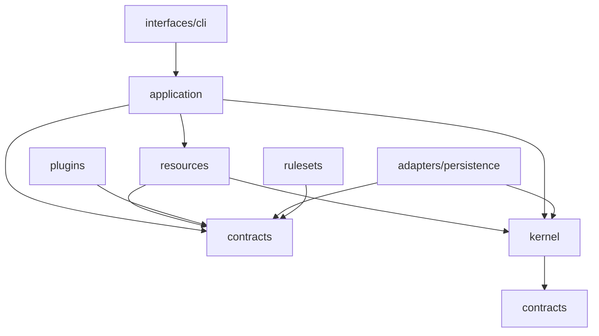

# RPGPRO — Arquitetura-Alvo e Kernel de Extensão

**Status:** baseline arquitetural aprovado para orientar a Fase 02 em diante; não é uma especificação de feature. Fases 01 e 01.5 concluídas; R0 e R0.5 concluídos (156 testes verdes); o próximo passo é a spec da Fase 02.
**Dono:** este documento é a fonte canônica da árvore de módulos, das portas de extensão e das regras de dependência.
**Relação com os demais documentos:** [`ROADMAP.md`](ROADMAP.md) governa fases e gates; [`rpgpro-diretrizes-agentes.md`](rpgpro-diretrizes-agentes.md) governa comportamento; [`DECISOES_ARQUITETURA.md`](DECISOES_ARQUITETURA.md) guarda o racional histórico; [`EXECUCAO.md`](EXECUCAO.md) registra o que foi feito.

> **Regra de ouro:** o núcleo é pequeno e invariável. O que varia vira porta + implementação + registro + configuração. “Plugável” não significa que tudo é plugin; significa que cada eixo de variação tem um contrato estável e um único ponto de composição.

---

## 1. Escopo

Este documento decide:

- o papel do event log, do Markdown e dos arquivos de configuração;
- o formato de armazenamento híbrido;
- as camadas, módulos e regras de dependência;
- o kernel de eventos, projeção, transação e plugins;
- as portas de extensão do sistema inteiro;
- a anatomia de um recurso autocontido;
- a sequência de refatoração R0–R4;
- os critérios de aceite arquiteturais.

Este documento **não** decide:

- o payload exato de cada evento, os detalhes de serialização/versionamento e a retenção (gate G1), respeitando o envelope e os IDs já fixados neste documento;
- a política de correção, dependências e reconstrução, incluindo seus efeitos sobre a história persistida (gate G2);
- o schema de conhecimento (gate G3);
- os valores de orçamento/fila (gate G4);
- o modelo de arco e os critérios do diretor (gate G5);
- o armazenamento/indexação da memória (gate G6);
- o harness de testes comportamentais (gate G7).

---

## 2. Decisões estruturantes

### D1 — Event log é a verdade; Markdown é projeção

- Toda alteração de estado do jogo é um evento append-only.
- `diario.md`, `ficha.md`, `npcs.md` e `faccoes.md` são projeções geradas.
- `mundo.md` e `regras.md` são **configuração** (lore, regras, calendário, plugins).
- Edição manual de projeção é exceção operacional: passa por `import-md` e gera evento de importação; o fluxo normal é por comando.
- O agente não escreve Markdown de estado diretamente; escreve eventos.

### D2 — Armazenamento híbrido

- **JSONL canônico** por campanha: append-only, segmentado, legível, diffável, backup junto da campanha.
- **SQLite derivado**: índice reconstruível para consultas, fila, dependências e campanhas longas.
- **Snapshots** periódicos para reconstrução rápida.
- O índice nunca é a verdade; se apagar, rebuilda do JSONL.
- Escrita: JSONL primeiro; índice depois; projeção por último. Falha no índice não invalida o evento.

### D3 — Monólito modular com kernel de plugins

- Um único processo, sem microserviços.
- Cada recurso (NPC, relógio, missão, facção, arco, conhecimento) tem seu próprio módulo vertical: modelo, regras, serviço, eventos e projeção.
- O kernel fornece eventos, transação, projeção, registro e configuração.
- O registro é **explícito** em `bootstrap.py`; sem descoberta automática na primeira versão.
- A configuração de plugins fica em `regras.md`, no bloco `plugins:`.

### D4 — Campanhas antigas serão descartadas

- Não há migração de estado legado nem `CampaignImported`.
- O primeiro evento de uma campanha nova é `campaign.created`.
- Antes de apagar as campanhas atuais: arquivar, criar fixtures de teste, atualizar a suíte, e só então remover.
- `campaigns/` passa a conter apenas campanhas novas; `tests/fixtures/campaigns/` contém os casos de teste.

### D5 — IA propõe; o motor valida e resolve

- A IA produz `Intent` (proposta), não fato.
- O motor valida identidade, capacidades, recursos, conhecimento, localização e pré-condições.
- A resolução usa o `ResolutionPolicy` da campanha.
- Só depois da validação/resolução o resultado vira evento.
- Plano, proposta e tentativa não são acontecimentos concluídos.

### D6 — Portas para os eixos de variação; kernel fixo

- O que varia por campanha, gênero, sistema ou upgrade futuro vira porta.
- O que garante integridade (envelope, transação, projeção, replay, IDs) permanece no kernel.
- Mudanças de invariante são versionadas, não “pluginizadas”.

---

## 3. Invariantes do kernel

Não são plugáveis na primeira versão:

1. **Envelope do evento**: identidade, tipo, versão de schema, tempo real, tempo de jogo, ator, causalidade, correlação, payload, metadados.
2. **Append-only e ordem**: `seq` monotônico por campanha; nenhuma edição ou remoção de evento.
3. **Fronteira transacional**: um lote de eventos por turno/ciclo; falha não deixa lote parcial.
4. **Pipeline**: `proposta → validação → resolução → evento → projeção`.
5. **Motor de projeção**: aplica projectors registrados em ordem; reconstruível.
6. **Replay e idempotência**: reaplicar eventos não duplica efeitos.
7. **IDs e erros**: formatos estáveis; erros tipados.
8. **Registro e composição**: um único `bootstrap.py`; sem singleton global mutável.
9. **Configuração**: validação de schema; defaults explícitos.
10. **Versionamento**: `api_version`, `schema_version`, `plugin_version`, `config_version`, `projection_version`.

Se um upgrade futuro precisar mudar um desses invariantes, ele é uma **migração de kernel** — deliberada, versionada e testada — não um plugin.

---

## 4. Camadas e dependências



Regras:

- `interfaces/cli` só traduz entrada/saída; não contém regra de domínio.
- `application` orquestra casos de uso e é dona da fronteira transacional.
- `resources` contêm domínio e serviços autocontidos; não importam CLI nem aplicação.
- `plugins` implementam portas; não importam `resources/*/service`, `projection` ou `adapters`.
- `adapters/persistence` implementam `EventStore`, `ProjectionWriter`, `Clock`; não contêm regra de negócio.
- `kernel` não conhece NPC, facção, d20 ou Markdown.
- `rulesets` implementam `ResolutionPolicy`; não importam CLI, aplicação ou persistência.
- Nenhum módulo de domínio importa `lazy_turn.py`.

---

## 5. Kernel

### 5.0 Base do kernel

O kernel transforma proposta em fato durável e reproduzível. Não decide o que acontece; garante que, uma vez aceito, o fato tem identidade, ordem, transação, projeção e replay.

Critério de corte:

- varia por campanha, sistema ou gênero → porta;
- se sumir, quebra replay ou auditoria → kernel;
- precisa de I/O para funcionar → adaptador;
- é política de jogo → recurso ou plugin.

Os dez invariantes da §3 se organizam em cinco responsabilidades:

| Responsabilidade | O kernel garante | O kernel não faz |
|---|---|---|
| Identidade | envelope imutável, `ActorRef`, `EventType` versionado, ID `evt_<ulid>` | decidir o payload de cada evento |
| Ordem | `seq` monotônico por campanha, append-only, leitura por stream | escolher onde gravar |
| Transação | lote all-or-nothing por turno, `expected_last_seq` | saber o que é um turno narrativo |
| Projeção | `Projector`s em ordem, checkpoint por `seq`, `dirty` e rebuild | formatar prosa ou Markdown |
| Composição | `Registry` congelado, `Runtime` imutável, um único `bootstrap.py` | descobrir plugin automaticamente |

Superfície pública do R0:

```text
contracts/
  event.py     ActorRef, EventDraft, Event, EventType, AppendResult
  ports.py     EventStore, Projector, Clock, CalendarProvider
  config.py    CampaignConfig
  serialization.py  normalização JSON e serialização canônica
kernel/
  errors.py    RpgError e subclasses com code estável
  ids.py       ULID monotônico: evt_<26 caracteres>
  registry.py  register/get/all/freeze e PluginManifest
  runtime.py   Runtime imutável e service(point, name)
  schema.py    validação de subconjunto de JSON Schema, sem dependência
bootstrap.py   build_runtime(campaign_id, config) -> Runtime
```

`Runtime` é um objeto imutável de composição: campanha, configuração e registry já congelado. Serviços não são acrescentados durante a execução; `bootstrap.py` é o único ponto que registra implementações e congela o registry antes de devolver o runtime. O parsing de Markdown, o calendário concreto e os caminhos de campanha ficam fora do kernel.

#### 5.0.1 Rascunho e fato

A aplicação produz `EventDraft`; o store produz `Event`. A aplicação nunca define `event_id`, `seq` ou `recorded_at`.

```python
@dataclass(frozen=True)
class EventDraft:
    type: str
    schema_version: int
    actor: ActorRef
    payload: Mapping[str, Any]
    game_time: str | None = None
    game_time_sort: int | None = None
    causation_id: str | None = None
    correlation_id: str | None = None
    meta: Mapping[str, Any] = field(default_factory=dict)

@dataclass(frozen=True)
class AppendResult:
    events: tuple[Event, ...]
    first_seq: int
    last_seq: int

class EventStore(Protocol):
    def append(self, campaign_id: str, drafts: Sequence[EventDraft],
               expected_last_seq: int | None = None) -> AppendResult: ...
    def read(self, campaign_id: str, after_seq: int = 0) -> Iterable[Event]: ...
    def last_seq(self, campaign_id: str) -> int: ...
```

Regras:

- `event_id` é `evt_<ulid>`; `seq` é monotônico por campanha; `recorded_at` é UTC ISO-8601. Os três são atribuídos pelo store, sob o mesmo lock que protege a escrita.
- `expected_last_seq` é comparado dentro de `append()`, na mesma seção crítica que atribui `seq`. Divergência → `SeqConflictError`. Ler `last_seq()` antes não é garantia de concorrência.
- `append()` é all-or-nothing: nenhum leitor observa lote parcial. O mecanismo (registro de lote ou gravação atômica de segmento) é decisão do G1.
- `payload` é validado como JSON serializável na construção; a serialização canônica (`sort_keys`, sem `NaN`) é a forma de igualdade e de hash.
- `last_seq()` existe para leitura e diagnóstico; não é pré-condição de escrita.

#### 5.0.2 R0 e R1

| | R0 (antes da Fase 02) | R1 (Fase 02) |
|---|---|---|
| Contratos | `event`, `ports`, `config` + fakes | implementações aprovadas pela suíte de contrato |
| Kernel | `errors`, `ids`, `registry`, `runtime`, `schema` | `events` (upcasters) e `projection` |
| Fora do kernel | extração de CLI, aplicação, persistência, `temporal/` e campanha | store JSONL, índice SQLite, `Projector`s, `resources/` |
| Emissão | nenhuma | eventos reais |
| Aceite | 157 testes automatizados verdes; `lazy_turn.py` com 54 linhas; Markdown idêntico | evento ida-e-volta; rebuild de projeção; idempotência |

No R0 os contratos são exercitados com um fake em memória (`FakeEventStore`) em `tests/contract_support.py` e nos testes `tests/test_contract_*.py`; a suíte de `Projector` acompanha o motor de projeção no R1. Nenhum evento real é emitido e nenhum plugin é registrado; a suíte de contrato é o aceite que as implementações do R1 precisam cumprir. `contracts/` e `kernel/` não fazem I/O e não importam `council`, `rulesets`, `resources`, `adapters` ou `interfaces`; um teste AST garante a fronteira.

### 5.1 Envelope do evento

```python
@dataclass(frozen=True)
class Event:
    event_id: str              # evt_<ulid>
    campaign_id: str
    seq: int                   # monotônico por campanha
    type: str                  # "npc.updated", "clock.advanced", ...
    schema_version: int
    recorded_at: str           # UTC ISO-8601, tempo real
    game_time: str             # data canônica da campanha
    game_time_sort: int        # minutos desde a época da campanha
    actor: ActorRef            # human | agent | system | npc | faction
    causation_id: str | None
    correlation_id: str | None
    payload: Mapping[str, Any]
    meta: Mapping[str, Any]    # plugin, versão, seed, context_hash
```

Este é o formato persistido e imutável. A escrita recebe `EventDraft` (§5.0.1): `event_id`, `seq` e `recorded_at` são atribuídos pelo store, nunca pela aplicação.

`game_time_sort` existe para consultas e ordenação sem reparsear calendários customizados. O `CalendarProvider` calcula o valor.

### 5.2 Manifesto de plugin

```python
@dataclass(frozen=True)
class PluginManifest:
    name: str
    version: str
    api_version: int
    provides: tuple[str, ...]       # ("behavior.npc", "projection.npcs")
    requires: tuple[str, ...]
    deterministic: bool
    config_schema: Mapping[str, Any]
```

- `provides` declara as portas implementadas.
- `requires` permite detectar dependência ausente na composição.
- `deterministic=False` obriga o registro do resultado no evento para replay.
- `config_schema` valida o bloco `plugins:` da campanha.

### 5.3 Registro e composição

```python
class Registry:
    def register(self, point: str, name: str, impl: Any) -> None: ...
    def get(self, point: str, name: str) -> Any: ...
    def all(self, point: str) -> list[Any]: ...
```

`bootstrap.py` é o único composition root e congela o registry antes de devolver o runtime; registro depois do congelamento é erro de composição:

```python
def build_runtime(campaign_id: str, config: CampaignConfig) -> Runtime:
    registry = Registry()
    registry.register("event_store", "jsonl", JsonlEventStore(...))
    registry.register("resolution", "d20_3gates", D20ThreeGates())
    registry.register("behavior.npc", "utility_v1", UtilityPolicy())
    registry.register("director", "causal_v1", CausalDirector())
    ...
    return Runtime(registry=registry, config=config)
```

Novo plugin = uma implementação + uma linha no `bootstrap.py` + configuração. Não há `if` espalhado pelo código.

### 5.4 Transação e projeção

```python
class EventStore(Protocol):
    def append(self, campaign_id: str, drafts: Sequence[EventDraft],
               expected_last_seq: int | None = None) -> AppendResult: ...
    def read(self, campaign_id: str, after_seq: int = 0) -> Iterable[Event]: ...
    def last_seq(self, campaign_id: str) -> int: ...

class Projector(Protocol):
    file: str
    section: str
    order: int
    def project(self, view: EventStreamView) -> ProjectionSection: ...
```

`append()` atribui identidade e ordem sob o lock e compara `expected_last_seq` na mesma seção crítica; divergência vira `SeqConflictError`. `last_seq()` serve para leitura e diagnóstico, não como garantia de concorrência.

Fluxo de `commit_turn`:

1. validar proposta;
2. resolver pela `ResolutionPolicy`;
3. montar lote de eventos;
4. `EventStore.append` valida o lote, compara `expected_last_seq`, atribui `seq` e grava (JSONL + fsync + lock);
5. atualizar índice SQLite;
6. executar projectors e gravar Markdown atomicamente;
7. registrar hash/versão da projeção;
8. devolver auditoria.

Se o passo 5 falhar, o JSONL é verdade e o índice é reconstruído. Se o passo 6 falhar, a projeção é marcada como `dirty` e reconstruída no próximo comando.

### 5.5 Tipos de evento e upcasters

O kernel não tem `if event_type == ...`. Recursos e plugins registram:

```python
@dataclass(frozen=True)
class EventType:
    type: str
    schema_version: int
    payload_schema: Mapping[str, Any]
    upcasters: Mapping[int, Callable[[Mapping[str, Any]], Mapping[str, Any]]]
```

Um tipo novo entra com schema, upcaster e projector; o kernel só valida o envelope.

---

## 6. Portas de extensão

### 6.1 Mapa completo

| Porta | Contrato | Exemplos | Fase |
|---|---|---|---|
| `EventStore` | append/read/last_seq | JSONL canônico, SQLite canônico futuro | 02 |
| `EventType` | tipo + schema + upcaster | novo fato, nova tentativa | 02 |
| `Projector` | seção de projeção | `diario.md`, `ficha.md`, `faccoes.md` | 02 |
| `ResolutionPolicy` | resolver `Intent` | d20 3 Portões, PbtA, storyteller | 02/05 |
| `BehaviorPolicy` | propor intenções de NPC | trait, utility, scripted, host bridge | 03 |
| `FactionPolicy` | propor planos de facção | expansão, conspiração, comércio | 03 |
| `KnowledgeProvider` | consultar conhecimento/crença | fato, boato, crença falsa | 03/07 |
| `ContextProvider` | contribuir com contexto | cena, arco, facção distante, memória | 04 |
| `SimulationPolicy` | decidir o que vence no tempo | tick por tempo, por evento | 05 |
| `BudgetPolicy` | selecionar trabalho sob orçamento | prioridade, urgência, dependência | 05 |
| `DirectorPolicy` | escolher o que narrar | causal, pacing, mistério | 06 |
| `StagnationPolicy` | detectar estagnação | metas, tensão, fios pendentes | 06 |
| `MemoryProvider` | recuperar memória | JSONL+índice, vetorial, híbrido | 07 |
| `ReviewRule` | emitir lint | continuidade, conhecimento, facção | 03–06 |
| `CalendarProvider` | parse/avançar data | gregoriano, Ventania | 01.5/05 |
| `NarrationPolicy` | mandatos de cena | standard, interlúdio, dossiê | 06 |

### 6.2 Contratos principais

```python
class ResolutionPolicy(Protocol):
    name: str
    def resolve(self, intent: Intent, ctx: ResolutionContext) -> ResolutionResult: ...

class BehaviorPolicy(Protocol):
    name: str
    version: str
    def propose(self, ctx: ReactionContext) -> tuple[Intent, ...]: ...

class FactionPolicy(Protocol):
    name: str
    version: str
    def propose(self, ctx: FactionContext) -> tuple[Intent, ...]: ...

class ContextProvider(Protocol):
    key: str
    priority: int
    def provide(self, ctx: ContextRequest) -> ContextSection: ...

class DirectorPolicy(Protocol):
    name: str
    def choose(self, ctx: DirectorContext) -> SceneDecision: ...

class MemoryProvider(Protocol):
    name: str
    def search(self, query: MemoryQuery) -> tuple[MemoryHit, ...]: ...

class ReviewRule(Protocol):
    code: str
    def check(self, view: ReviewView) -> tuple[ReviewIssue, ...]: ...

class CalendarProvider(Protocol):
    name: str
    def parse(self, text: str) -> CampaignDate | None: ...
    def advance(self, date: CampaignDate, minutes: int) -> CampaignDate: ...
    def sort_key(self, date: CampaignDate) -> int: ...
```

### 6.3 Regras para qualquer plugin

1. Recebe **views imutáveis**; nunca repositórios ou caminhos de arquivo.
2. Não faz I/O, não chama LLM, não grava, não projeta.
3. Não importa `resources/*/service`, `projection` ou `interfaces`.
4. Devolve proposta/seção/decisão/lint; nunca evento final.
5. É determinístico quando `deterministic=True`; usa `seed` do contexto.
6. Declara `api_version` e `version`; mudança incompatível sobe `api_version`.
7. Passa pela suíte de contrato da porta antes de ser registrado.
8. Não guarda estado global mutável entre chamadas.

### 6.4 Plugin de LLM/host

O repositório não chama modelo. Propostas de LLM entram por uma porta de host:

- `HostProposalGateway` monta `DecisionRequest` com contexto e schema de `Intent`;
- o agente externo devolve `Intent` estruturada;
- o motor valida e resolve como qualquer proposta;
- o evento registra `policy`, `policy_version`, `context_hash`, `intent` e `deterministic=false`;
- replay usa o `intent` gravado, nunca uma nova chamada.

---

## 7. Recursos e donos de estado

| Recurso | Estado que possui | Eventos | Projeção |
|---|---|---|---|
| `protagonist` | vitais, atributos, progressão, inventário, reputação | `protagonist.*` | `ficha.md` |
| `npcs` | identidade, traços, objetivos, planos, recursos, status, relações | `npc.*` | `npcs.md` |
| `clocks` | valor, máximo, gatilho, status | `clock.*` | `diario.md` |
| `quests` | objetivos, status, contratante, vínculo a clock | `quest.*` | `diario.md` |
| `factions` | objetivos, planos, liderança, subgrupos, recursos | `faction.*` | `faccoes.md` |
| `arcs` | direção, marcos, condições de conclusão | `arc.*` | `diario.md` |
| `knowledge` | fatos, crenças, fontes, donos, confiança | `knowledge.*` | `npcs.md`/`faccoes.md`/`ficha.md` |

Anatomia de um recurso:

```text
resources/<nome>/
  model.py        # entidades e value objects
  rules.py        # invariantes e políticas do recurso
  service.py      # comandos e consultas públicas
  events.py       # tipos de evento emitidos
  projection.py   # seções de projeção
  contracts.py    # views e portas específicas (se necessário)
```

Regras:

- O serviço retorna `DomainResult(events, views)`; não grava.
- A aplicação coleta eventos de vários recursos e grava um lote.
- Recurso não importa o repositório de outro recurso.
- Interação entre recursos: chamada de serviço via porta ou reação a evento; a aplicação coordena.
- `knowledge` é recurso próprio; NPC/facção referenciam `knowledge_id`, não copiam fatos.
- `protagonist` e `npcs` compartilham o conceito de personagem, mas têm schemas e serviços distintos.

---

## 8. Armazenamento e projeções

### 8.1 Layout por campanha

```text
campaigns/<id>/
  campaign.jsonl              # configuração imutável de criação? ou config/
  events/
    000001.jsonl
    000002.jsonl
  snapshots/
    000001.json
  index.sqlite                # derivado, descartável
  projections/
    diario.md
    ficha.md
    npcs.md
    faccoes.md
  config/
    mundo.md
    regras.md
  artifacts/
    ...                       # importações, anexos, diário legado
```

`mundo.md`/`regras.md` podem continuar na raiz da campanha para compatibilidade; o importante é que sejam configuração, não projeção.

### 8.2 Escrita

1. `EventStore.append` valida o lote, adquire o lock, atribui `seq`, grava no segmento atual, `fsync`.
2. Índice SQLite é atualizado; falha marca `index_dirty`.
3. Projectors geram seções; `ProjectionWriter` grava cada arquivo atomicamente.
4. Hash da projeção é registrado para detectar edição manual.

### 8.3 Leitura

- `prepare` lê projeções e/ou índice; não reparseia o log inteiro.
- Consultas históricas usam `EventStore.read` + índice.
- Rebuild: snapshot mais recente + eventos seguintes; projeção reconstruída.

### 8.4 Retenção e campanhas longas

- Segmentos por volume (ex.: 1.000 eventos ou 1 MB).
- Snapshot a cada N eventos ou por arco.
- Eventos antigos não são apagados; segmentos podem ser arquivados.
- Arcos fecham, campanha continua; não há final forçado.

### 8.5 Edição manual

- Projeção é somente leitura no fluxo normal.
- `import-md` lê o Markdown, gera `manual.imported` com diff e reescreve a projeção.
- Se o hash da projeção não bater, o comando avisa e exige `--rebuild` ou `--import`.

---

## 9. Fluxos de aplicação

### 9.1 `prepare_turn`

1. carregar configuração e runtime;
2. ler projeções/índice;
3. coletar `ContextProvider`s por prioridade;
4. montar núcleo obrigatório + contexto causal + consulta sob demanda;
5. devolver `TurnContext` com `unknown`/`unavailable`/`inexistent` explícitos.

### 9.2 `commit_turn`

1. receber `Intent`/resultado narrado;
2. validar pré-condições via recursos;
3. resolver via `ResolutionPolicy`;
4. montar lote de eventos;
5. append + índice + projeção;
6. rodar `ReviewRule`s;
7. devolver auditoria.

### 9.3 `advance_world`

1. calcular tempo decorrido;
2. `SimulationPolicy` seleciona trabalho devido;
3. `BudgetPolicy` limita o ciclo;
4. recursos resolvem planos/relógios;
5. eventos são gravados;
6. fila persistente guarda o que não coube;
7. projeções atualizadas.

### 9.4 `run_director`

1. ler fios pendentes (relógios, missões, planos, consequências);
2. `StagnationPolicy` detecta estagnação;
3. `DirectorPolicy` escolhe a cena;
4. `SceneDecision` é registrada;
5. narração respeita o controle de revelação.

---

## 10. Como adicionar uma extensão

### 10.1 Novo algoritmo de comportamento de NPC

1. criar `plugins/behavior/<nome>.py` implementando `BehaviorPolicy`;
2. registrar em `bootstrap.py`;
3. configurar `plugins.behavior.npc: <nome>` em `regras.md`;
4. adicionar testes de contrato com contextos dourados;
5. registrar em `EXECUCAO.md`.

Nada muda em `commit`, projeção, event store ou narrador.

### 10.2 Novo sistema de resolução

1. criar `plugins/resolution/<nome>.py` implementando `ResolutionPolicy`;
2. registrar;
3. configurar `plugins.resolution: <nome>`;
4. testar `Intent` → `ResolutionResult`;
5. nenhum recurso precisa saber qual sistema está ativo.

### 10.3 Novo tipo de evento

1. declarar `EventType` no recurso, com schema e upcaster;
2. registrar no `EventRegistry`;
3. criar/estender `Projector`;
4. testar evento ida-e-volta e rebuild;
5. o kernel não ganha `if` novo.

### 10.4 Nova seção/projeção

1. criar `Projector` com `file`, `section`, `order`;
2. registrar;
3. testar colisão de seção e rebuild;
4. nenhuma alteração no escritor central.

### 10.5 Nova fonte de contexto

1. criar `ContextProvider`;
2. registrar com prioridade;
3. testar `unknown`/`unavailable`/`inexistent`;
4. o `prepare` não precisa de alteração estrutural.

### 10.6 Novo diretor, memória, calendário ou lint

Mesmo padrão: contrato + implementação + registro + config + teste de contrato.

---

## 11. Versionamento, replay e testes

### 11.1 Versões

- `api_version` por porta (quebra de contrato).
- `schema_version` por tipo de evento (upcasters).
- `plugin_version` (comportamento).
- `config_version` (formato de configuração).
- `projection_version` (layout do Markdown).

### 11.2 Determinismo e replay

- Plugins determinísticos recebem `seed` e podem ser reexecutados.
- Plugins não determinísticos (host/LLM) gravam a saída no evento.
- Replay usa o evento gravado; nunca reexecuta LLM.
- Eventos antigos passam por upcasters antes de projetar.

### 11.3 Testes obrigatórios

- **Contrato de porta:** cada implementação passa pela mesma suíte.
- **Contexto dourado:** entradas fixas, saídas esperadas.
- **Replay:** reconstruir estado de N eventos e comparar projeções.
- **Idempotência:** aplicar o mesmo lote duas vezes não duplica efeitos.
- **Dependências:** correção reavalia apenas afetados.
- **Comportamento:** os dez cenários do documento de diretrizes.
- **Arquitetura:** teste de importação proibida, limite de linhas, ausência de I/O em plugin.

---

## 12. Refatoração R0–R4

| Etapa | Quando | O que move | Aceite |
|---|---|---|---|
| **R0** | Antes da Fase 02 (Concluído) | criar `contracts/` (envelope, portas, config), `kernel/` (errors, ids, registry, runtime, schema), `bootstrap.py` e suíte de contrato com fakes; extrair CLI, persistência, `temporal/` e campanha de `lazy_turn.py`/`helpers.py`; nenhum evento emitido | 156 testes verdes; `lazy_turn.py` com 54 linhas; Markdown idêntico; contratos exercitados com fakes; nenhum plugin |
| **R0.5** | Antes da Fase 02 (Concluído) | arquivar campanhas em `archive/campaigns/`, criar fixtures em `tests/fixtures/`, atualizar testes, limpar `campaigns/` com `.gitkeep` | suíte verde sem campanhas reais; `init-campaign` funciona com verificação all-or-nothing |
| **R1** | Fase 02 | `ssot.py` → `resources/`; `EventStore` JSONL + índice; `Projector`s; `EventType`s e upcasters | evento ida-e-volta; rebuild de projeção; implementações aprovadas na suíte de contrato; nenhum arquivo > 300 |
| **R2** | Fases 03/04 | `narrator.py` → `resources/npcs/`; `factions.py` → `resources/factions/`; `quests.py` → `resources/quests/`; `context/` | módulos < 300; sem ciclos; `BehaviorPolicy`/`FactionPolicy`/`ContextProvider` testados |
| **R3** | Fases 05/06 | `reviewer.py` → `review/`; `world/` com `SimulationPolicy`, `BudgetPolicy`, `DirectorPolicy`, `StagnationPolicy` | lints independentes; diretor determinístico; orçamento testado |
| **R4** | Fase 07 | `memory/`, `knowledge/` | proveniência rastreável; resumos reconstruíveis |

R0 é behavior-preserving. R1–R4 acompanham as fases; não são uma “refatoração geral” separada.

---

## 13. Fases e gates

| Fase | O que a arquitetura habilita | Gate |
|---|---|---|
| 01 | fundação de persistência/validação | — |
| 01.5 | concluída: `CalendarProvider` de Valíria e `faction --rep` estrito; R0.5 cobre reset/fixtures | — |
| 02 | event store, projeção, correções, fila | G1, G2 |
| 03 | `BehaviorPolicy`, `FactionPolicy`, `KnowledgeProvider` | G3 |
| 04 | `ContextProvider`, contexto causal | schema de evento/agente |
| 05 | `SimulationPolicy`, `BudgetPolicy`, fila | G4 |
| 06 | `DirectorPolicy`, `StagnationPolicy`, arcos flexíveis | G5 |
| 07 | `MemoryProvider`, resumos derivados | G6 |
| 08 | suíte de comportamento e migração | G7 |

Os gates continuam definidos no [`ROADMAP.md`](ROADMAP.md). A arquitetura não os antecipa.

---

## 14. Riscos e trade-offs

| Risco | Mitigação |
|---|---|
| Abstração excessiva | começar com poucos ports; cada porta nasce de uma necessidade de fase |
| “Sopa de plugins” | contratos pequenos, manifesto, registro explícito, revisão de API |
| Drift de contrato | `api_version`, suíte de contrato, depreciação |
| Performance de replay | snapshots + índice SQLite derivado; segmentação |
| Plugin não determinístico | gravar saída no evento; replay não reexecuta LLM |
| Plugin com I/O | views imutáveis; teste de importação/IO; revisão |
| Acoplamento residual | teste de dependências; plugins não importam `resources/service` |
| Perda de legibilidade | Markdown continua projeção legível; JSONL é texto |
| Reset de campanhas | arquivar antes; fixtures antes de apagar |
| Complexidade de testes | suíte de contrato + cenários dourados + replay |

---

## 15. Critérios de aceite da arquitetura

1. `lazy_turn.py` < 200 linhas; nenhuma regra de domínio nele.
2. Nenhum arquivo > 300 linhas como alvo; 400 alerta; 600 falha.
3. Teste de dependências sem ciclos proibidos.
4. Plugins sem I/O, sem importar `resources/service`/`projection`.
5. Toda escrita de estado via `EventStore`/`Projector`; nenhum `write_text` fora de adaptadores.
6. Rebuild de projeção reproduz o Markdown a partir do JSONL.
7. Replay idempotente; eventos antigos passam por upcasters.
8. Configuração validada contra `config_schema`.
9. Suíte de contrato por porta.
10. 156 testes automatizados verdes após R0/R0.5 e reparos de QA; suíte de contrato verde.
11. Campanhas de teste em `tests/fixtures/campaigns/`, sem dependência das campanhas reais.
12. `EXECUCAO.md` atualizado a cada etapa.
13. `contracts/` e `kernel/` sem I/O e sem imports de `council`, `rulesets`, `resources`, `adapters` ou `interfaces`.

---

## 16. Próximos passos

1. R0 concluído (contratos, kernel, bootstrap e extração modular).
2. R0.5 concluído (arquivamento de campanhas, fixtures isoladas e campaigns/ limpo com .gitkeep).
3. Auditoria de QA da Fundação/R0/R0.5 concluída e itens P1/P2 resolvidos.
4. Escrever a spec da Fase 02 (G1/G2): payloads, serialização/versionamento, retenção, projeções, correções, dependências e fila.
5. Executar **R1 + Fase 02**.
6. Seguir para R2–R4 conforme as fases.

Enquanto G1/G2 não estiverem fechados, a Fase 02 pode ter protótipo e testes de contrato, mas não deve ser declarada concluída.
