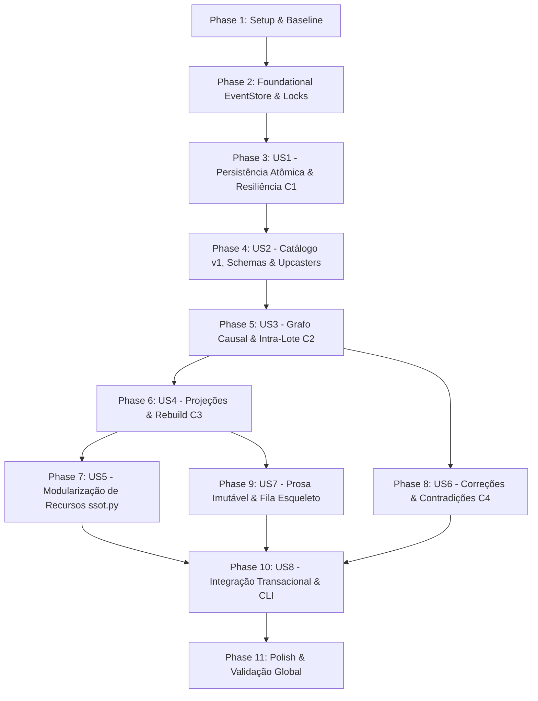

# Implementation Tasks: 010 — Fase 02: História Causal & Refatoração R1

**Feature:** `phase-02-causal-history`  
**Spec:** [`spec.md`](spec.md)  
**Plan:** [`plan.md`](plan.md)  
**Research:** [`research.md`](research.md)  
**Data Model:** [`data-model.md`](data-model.md)  
**Contracts:** [`contracts/store_and_projection_contracts.md`](contracts/store_and_projection_contracts.md)  
**Quickstart:** [`quickstart.md`](quickstart.md)  
**Status:** Completed — 50/50 tarefas; 211 testes; QA final aprovado em 26/10/2026.

---

## Dependencies & Execution Strategy

* **MVP Scope:** Phases 1 a 4 (Setup, Fundação, US1 Persistência Atômica com Resiliência C1 e US2 Catálogo v1 com Schemas e Upcasters).
* **Incremento 2:** Phases 5 e 6 (US3 Grafo Causal Intra-Lote C2 e US4 Projeções determinísticas com Rebuild C3).
* **Incremento 3:** Phases 7 a 11 (US5 Refatoração de recursos, US6 Correções C4, US7 Prosa/Fila, US8 Integração e Polish).

---

## Phase 1: Setup & Baseline Isolation

- [x] T001 Executar a suíte de testes de regressão completa confirmando 157/157 testes verdes em `tests/`
- [x] T002 [P] Configurar diretório de fixtures e scratch para testes de persistência em `.tmp/test_scratch/` garantindo permissões herdadas sem elevação de privilégios

---

## Phase 2: Foundational Tasks

- [x] T003 [P] Implementar utilitário de travamento cooperativo por campanha `CampaignLock` com timeout configurável em `adapters/persistence/lock.py`
- [x] T004 [P] Implementar funções canônicas de hashing SHA-256 para eventos e lotes `hash_event(event: Event) -> str` e `hash_batch(events: Sequence[Event]) -> str` em `contracts/serialization.py`
- [x] T005 [P] Criar exceções tipadas de domínio `DuplicateBatchError`, `DependencyError`, `DependencyCycleError`, `DependencyDepthError` e `InvalidDraftError` em `kernel/errors.py`

---

## Phase 3: User Story 1 — Persistência Atômica, Marcadores e Resiliência a Crashes (Priority: P1)

*Goal*: Implementar o `JsonlEventStore` particionado por segmentos com marcadores `batch.open`/`batch.committed` e recuperação automática no append via truncamento de cauda órfã (Critério C1).  
*Independent Test Criteria*: Interromper a escrita antes e durante o marcador `batch.committed` não deixa nenhum evento visível para `read()`, e o próximo `append()` trunca o segmento órfão até o último `committed` antes de gravar novos eventos.

- [x] T006 [P] [US1] Implementar resolução de caminhos de segmentos `events/<segment:06d>.jsonl` com rotação aos 1.000 eventos ou 1 MB em `adapters/persistence/event_store.py`
- [x] T007 [P] [US1] Implementar escrita atômica com marcadores `{"record":"batch","state":"open",...}` e `{"record":"batch","state":"committed","hash":"sha256:...",...}` com flush e `os.fsync` em `adapters/persistence/event_store.py`
- [x] T008 [US1] Implementar rotina de recuperação por truncamento (Critério C1) que descarta caudas com `batch.open` sem `batch.committed` antes de aceitar nova escrita em `adapters/persistence/event_store.py`
- [x] T009 [US1] Implementar validação estrita de `expected_last_seq` sob lock disparando `SeqConflictError` e rejeitar rascunhos sem `game_time` ou `game_time_sort` com `InvalidDraftError` em `adapters/persistence/event_store.py`
- [x] T010 [US1] Implementar método `read(campaign_id, after_seq)` e `last_seq(campaign_id)` ignorando lotes não confirmados em `adapters/persistence/event_store.py`
- [x] T011 [P] [US1] Conectar `JsonlEventStore` na suíte de contrato `EventStoreContract` em `tests/test_contract_event_store.py`
- [x] T012 [US1] Criar testes de simulação de crash e recuperação (Critério C1) em `tests/test_event_store_crash_recovery.py` interrompendo a escrita em 3 pontos críticos

---

## Phase 4: User Story 2 — Catálogo Canônico v1, Schemas e Upcasters (Priority: P1)

*Goal*: Registrar os 23 tipos de eventos do catálogo v1 com schemas de payload estritos, validação no append e suporte a upcasters $N \to N+1$.  
*Independent Test Criteria*: Eventos com schema inválido ou tipo desconhecido são rejeitados no `append()`; eventos lidos com versões antigas são convertidos por upcasters, e versões futuras disparam `SchemaError`.

- [x] T013 [P] [US2] Definir os schemas de payload dos 23 tipos de eventos v1 em conformidade com o data model em `kernel/event_catalog.py`
- [x] T014 [P] [US2] Implementar upcasters $1 \to 2$ de teste e validador de versões futuras em `kernel/event_catalog.py`
- [x] T015 [US2] Registrar os 23 `EventType`s no `Registry` congelado via `bootstrap.py`
- [x] T016 [US2] Integrar validação de payload contra o schema do tipo registrado e rejeição de tipos desconhecidos com `UnknownEventTypeError` em `adapters/persistence/event_store.py`
- [x] T017 [US2] Criar testes unitários para todos os 23 tipos de eventos e upcasters em `tests/test_event_catalog.py`

---

## Phase 5: User Story 3 — Grafo de Dependências Causal & Dependências Intra-Lote (Priority: P1)

*Goal*: Garantir aciclicidade e profundidade $\le 64$ nas dependências causais, permitindo referências a eventos anteriores do mesmo lote (Critério C2).  
*Independent Test Criteria*: Um lote com `[draft_A, draft_B (dep draft_A), draft_C (dep draft_B)]` é validado e persistido com sucesso; dependências para frente no lote ou ciclos geram erro imediato.

- [x] T018 [P] [US3] Implementar classe `DependencyGraph` com detecção de ciclos (Tarjan/DFS) e teto de profundidade 64 em `kernel/dag.py`
- [x] T019 [US3] Implementar validação intra-lote (Critério C2) resolvendo dependências entre IDs provisórios que antecedem o evento no mesmo lote em `kernel/dag.py`
- [x] T020 [US3] Integrar a validação de `DependencyGraph` no método `append()` de `adapters/persistence/event_store.py`
- [x] T021 [US3] Criar testes unitários de grafo causal e validação intra-lote em `tests/test_causal_dag.py`

---

## Phase 6: User Story 4 — Motor de Projeções Determinístico & Rebuild com Auditoria Isolada (Priority: P1)

*Goal*: Implementar projectors para `diario.md`, `ficha.md` e `npcs.md`, permitindo rebuild byte-idêntico onde o evento de auditoria `projection.rebuilt` não altera o hash auditado (Critério C3).  
*Independent Test Criteria*: Executar rebuild a partir do event log recria os 3 Markdown com hashes idênticos ao fluxo normal, e a emissão posterior de `projection.rebuilt` não altera o hash das projeções em disco.

- [x] T022 [P] [US4] Implementar `JournalProjector` (projeção para `diario.md`) em `application/projectors/journal.py`
- [x] T023 [P] [US4] Implementar `CharacterSheetProjector` (projeção para `ficha.md`) em `application/projectors/sheet.py`
- [x] T024 [P] [US4] Implementar `NpcProjector` (projeção para `npcs.md`) em `application/projectors/npc.py`
- [x] T025 [US4] Implementar `ProjectionEngine` e gravação atômica via `ProjectionWriter` com cálculo de `projection_hash` em `application/projection_engine.py`
- [x] T026 [US4] Implementar serviço `rebuild_projections` em `application/rebuild.py` com suporte a snapshots periódicos em `snapshots/<seq:06d>.json`
- [x] T027 [US4] Implementar isolamento do evento `projection.rebuilt` (Critério C3) emitido após o cálculo e validação do hash em `application/rebuild.py`
- [x] T028 [US4] Criar testes de reconstrução determinística, idempotência e ausência de autoinfluência no hash em `tests/test_projection_rebuild.py`

---

## Phase 7: User Story 5 — Modularização do SSOT para Módulos de Recursos (Priority: P2)

*Goal*: Desmembrar `council/ssot.py` em submódulos especializados em `resources/` rigorosamente abaixo de 300 linhas cada, preservando a API legada como wrappers.  
*Independent Test Criteria*: Todos os testes existentes que importam funções de `council.ssot` continuam passando sem alteração, e nenhum arquivo no novo pacote `resources/` ultrapassa 300 linhas de código.

- [x] T029 [P] [US5] Extrair lógica de relógios para `resources/clocks.py` (< 300 linhas)
- [x] T030 [P] [US5] Extrair lógica de ficha e vitais do protagonista para `resources/sheet.py` (< 300 linhas)
- [x] T031 [P] [US5] Extrair lógica de ledger cronológico e reputação para `resources/ledger.py` (< 300 linhas)
- [x] T032 [P] [US5] Extrair lógica de progressão e XP para `resources/progression.py` (< 300 linhas)
- [x] T033 [US5] Refatorar `council/ssot.py` como fachada delegadora para os módulos de `resources/` preservando assinaturas públicas
- [x] T034 [US5] Atualizar `tests/test_architecture_boundaries.py` para validar limites de linhas (< 300) e ausência de imports proibidos no novo pacote `resources/`

---

## Phase 8: User Story 6 — Subsistema de Correções, Compensações e Contradições (Priority: P1)

*Goal*: Processar correções como fatos append-only (`correction.issued`), reavaliando dependentes com eventos de compensação e registrando inconsistências quando premissas forem invalidadas sem mutação silenciosa (Critério C4).  
*Independent Test Criteria*: Corrigir concessão de XP gera evento compensatório sem alterar o evento original nem projeções não relacionadas; corrigir fato contraditório anota `inconsistency_detected: true` e acusa pendência no reviewer.

- [x] T035 [P] [US6] Implementar serviço `CorrectionService` em `application/correction.py` emitindo `correction.issued` append-only
- [x] T036 [US6] Implementar cálculo de eventos compensatórios numéricos com `meta.correction_id` para XP, atributos e relógios em `application/correction.py`
- [x] T037 [US6] Implementar detecção de contradições causais (Critério C4) emitindo `correction.recomputed` com flag de inconsistência em `application/correction.py`
- [x] T038 [US6] Atualizar linter em `council/reviewer.py` para detectar inconsistências causais pendentes de resolução humana
- [x] T039 [US6] Criar testes unitários e de integração de correções e compensações em `tests/test_causal_correction.py`

---

## Phase 9: User Story 7 — Prosa Imutável e Fila Esqueleto Append-Only (Priority: P2)

*Goal*: Armazenar prosas narrativas em artefatos imutáveis verificáveis por hash e registrar tarefas operacionais na fila esqueleto `queue.jsonl`.  
*Independent Test Criteria*: Todo turno gera arquivo em `artifacts/prose/turn_{seq:06d}-{hash}.md` auditável por `prose.recorded`; tarefas em `queue.jsonl` transitam de `pending` para `done`/`failed` exclusivamente via novos appends.

- [x] T040 [P] [US7] Implementar `ProseStore` em `application/prose_store.py` gravando textos imutáveis em `artifacts/prose/` e validando hashes SHA-256
- [x] T041 [P] [US7] Implementar `SkeletonQueue` em `adapters/persistence/skeleton_queue.py` com escrita append-only em `queue.jsonl`
- [x] T042 [US7] Criar testes unitários para armazenamento de prosa e fila esqueleto em `tests/test_prose_and_queue.py`

---

## Phase 10: User Story 8 — Integração Transacional, CLI e Comandos de Rebuild/Correct (Priority: P1)

*Goal*: Integrar a emissão de eventos e projeções no pipeline de `commit_turn` e expor os novos subcomandos `rebuild` e `correct` na CLI.  
*Independent Test Criteria*: Executar `lazy_turn.py commit` persiste lote de eventos no JSONL e atualiza projeções atomicamente; comandos `lazy_turn.py rebuild` e `lazy_turn.py correct` operam diretamente via CLI.

- [x] T043 [US8] Atualizar `application/commit.py` para construir lote atômico de `EventDraft`s, persistir via `EventStore.append()` e atualizar projeções
- [x] T044 [US8] Adicionar subcomando `rebuild` em `lazy_turn.py:build_cli()` e handler `cmd_rebuild` em `application/showrunner.py`
- [x] T045 [US8] Adicionar subcomando `correct` em `lazy_turn.py:build_cli()` e handler `cmd_correct` em `application/showrunner.py`
- [x] T046 [US8] Adicionar testes de contrato da CLI em `tests/test_cli_contracts.py` cobrindo `rebuild` e `correct`
- [x] T047 [US8] Executar os 11 cenários de teste do `quickstart.md` em campanha isolada de teste `_qa_causal_r1`

---

## Phase 11: Polish & Cross-Cutting Verification Gate

*Goal*: Garantir conformidade com os limites arquiteturais (< 300 linhas, < 200 linhas no entry point), executar a suíte completa 100% verde e registrar a execução.  
*Independent Test Criteria*: `tests/test_architecture_boundaries.py` passa sem ressalvas; suíte completa de testes passa sem regressões; nova entrada `EX-0014` gravada em `EXECUCAO.md`.

- [x] T048 Verificar cumprimento dos limites de tamanho de arquivo (< 300 linhas por módulo, < 200 linhas em `lazy_turn.py`)
- [x] T049 Executar suíte de testes de regressão completa `python -m unittest discover -s tests` confirmando 100% verde
- [x] T050 Registrar a execução formal do R1 em `EXECUCAO.md` sob a entrada `EX-0014` com links para a spec, plano e testes
