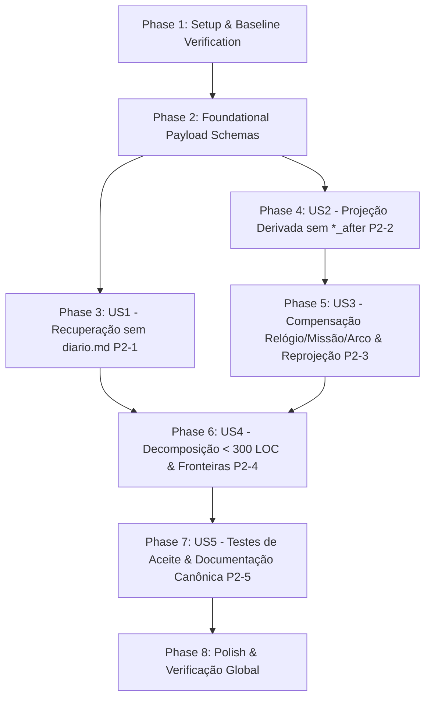

# Implementation Tasks: 011 — Fechamento dos 5 Achados P2 do QA da Fase 02/R1

**Feature**: `close-phase02-qa-p2`  
**Spec**: [`spec.md`](spec.md)  
**Plan**: [`plan.md`](plan.md)  
**Research**: [`research.md`](research.md)  
**Data Model**: [`data-model.md`](data-model.md)  
**Contracts**: [`contracts/qa_p2_remediation_contracts.md`](contracts/qa_p2_remediation_contracts.md)  
**Quickstart**: [`quickstart.md`](quickstart.md)  
**Status**: Completed  

---

## Dependencies & Execution Strategy

* **MVP Scope**: Phases 1 a 4 (`US1` Recuperação sem `diario.md` [P2-1] e `US2` Reconstrução pura sem blobs `*_after` [P2-2]).
* **Incremento 2**: Phase 5 (`US3` Compensação causal de relógio, missão e arco com reprojeção imediata [P2-3]).
* **Incremento 3**: Phases 6 a 8 (`US4` Decomposição de módulos < 300 LOC e fronteiras [P2-4], `US5` Suíte de testes e sincronização documental [P2-5]).

---

## Phase 1: Setup & Baseline Verification

- [X] T001 Executar a suíte de testes atual (`python -m unittest discover -s tests -p "test_*.py"`) confirmando o baseline de 206 testes verdes em `tests/`

---

## Phase 2: Foundational Tasks (Schemas & Contratos de Payload)

- [X] T002 Atualizar os schemas de payload em `contracts/catalog.py` para suportar todos os campos semânticos necessários à projeção pura (`vitals_line`, `state_shift`, `alerts`, `restored_vitals` em `turn.committed`; `phase`, `evidence`, `objective`, `turn` em `quest.*`; `delta_favors`, `delta_debts`, `turn`, `quest_id` em `faction.reputation_changed`; `turn`, `base_step`, `skip_ledger` em `protagonist.progression_changed`; `delta`, `training` em `protagonist.sheet_changed`; `files` em `command.executed`)

---

## Phase 3: User Story 1 — Recuperação de Campanha após Perda de `diario.md` (P2-1)

*Goal*: Permitir que `rebuild` localize e reconstrua uma campanha quando `diario.md` (e/ou `ficha.md`, `npcs.md`) estiver ausente na raiz mas `events/` existir, mantendo a falha rápida para comandos normais.  
*Independent Test Criteria*: Deletar `diario.md` da raiz de uma campanha com eventos em `events/`, executar `cmd_rebuild(campaign_id)` e verificar que `diario.md` é restaurado byte-idêntico a `projections/diario.md` e passa em `cmd_review(campaign_id)` com `ssot_status == "CLEAN"`.

- [X] T003 [US1] Adicionar o parâmetro `allow_missing_projections: bool = False` em `find_campaign` dentro de `campaign/locator.py`, resolvendo `schema_version` a partir de `projections/diario.md` ou `events/000001.jsonl` (default `1`) quando `allow_missing_projections=True` e levantando `FileNotFoundError` se nem `diario.md`, nem `projections/diario.md`, nem segmentos em `events/` existirem
- [X] T004 [US1] Atualizar `_serialized_campaign_mutation` em `application/transaction.py` e `cmd_rebuild` em `application/showrunner.py` para passar `allow_missing_projections=True` durante o fluxo de `rebuild`

---

## Phase 4: User Story 2 — Reconstrução Pura Derivada de Eventos sem Blobs em `meta` (P2-2)

*Goal*: Eliminar `diario_after`, `ficha_after` e `npcs_after` de `event.meta` em todos os turnos e comandos, fazendo `JournalProjector`, `CharacterSheetProjector` e `NpcProjector` derivarem 100% do estado a partir dos payloads dos eventos sobre o baseline inicial de `campaign.created`.  
*Independent Test Criteria*: Após executar `init-campaign`, comandos (`clock`, `quest`, `progress`, `faction`, `plan`, `arc`, `upsert-npc`), `commit` e `rebuild --force`, zero eventos no log possuem `diario_after`, `ficha_after` ou `npcs_after` em `meta`, e os hashes de `diario.md`, `ficha.md` e `npcs.md` na raiz coincidem byte a byte com `projections/`.

- [X] T005 [US2] Remover `diario_after`, `ficha_after` e `npcs_after` de `build_commit_event_drafts` em `application/commit_events.py` e enriquecer os payloads de `turn.committed`, `protagonist.sheet_changed`, `protagonist.progression_changed`, `npc.updated`, `clock.*`, `quest.*` e `faction.reputation_changed`
- [X] T006 [US2] Remover `diario_after`, `ficha_after` e `npcs_after` de `record_command_mutation` e de `ensure_campaign_event_log` em `application/transaction.py` (usando `payload.files` no evento `command.executed` de `sync` apenas para edições manuais externas)
- [X] T007 [P] [US2] Enriquecer os payloads dos eventos emitidos por `cmd_clock`, `cmd_plan` e `cmd_arc` em `application/showrunner.py`, `cmd_quest` e `cmd_progress` em `application/progression.py`, `cmd_faction` em `application/factions.py` e `upsert-npc` em `interfaces/cli/main.py`
- [X] T008 [P] [US2] Refatorar `JournalProjector` em `application/projectors/journal.py` para remover `meta["diario_after"]` e aplicar deterministicamente todos os eventos de diário (`clock.*`, `quest.*`, `scene.*`, `arc.updated`, `protagonist.progression_changed`, `faction.reputation_changed`, `turn.committed`, `correction.*`, `command.executed`) reutilizando as funções de domínio
- [X] T009 [P] [US2] Refatorar `CharacterSheetProjector` em `application/projectors/sheet.py` para remover `meta["ficha_after"]` e aplicar deterministicamente todos os eventos de ficha (`protagonist.progression_changed`, `protagonist.sheet_changed`, `faction.reputation_changed`, `turn.committed`, `command.executed`) reutilizando as funções de domínio
- [X] T010 [P] [US2] Refatorar `NpcProjector` em `application/projectors/npc.py` para remover `meta["npcs_after"]` e aplicar deterministicamente `npc.updated` (modos `turn_update` e `upsert`) reutilizando `apply_npc_updates_to_md` e `upsert_npc_to_md`

---

## Phase 5: User Story 3 — Compensação Causal de Relógios, Missões e Arcos com Reprojeção Automática (P2-3)

*Goal*: Estender `CorrectionService` e o comando CLI `correct` para compensar relógios (`clock`), missões (`quest`) e arcos (`arc`), além de XP, ficha/vitais e reputação, atualizando automaticamente as projeções após qualquer correção ou resolução.  
*Independent Test Criteria*: Emitir correções via `CorrectionService` e via `cmd_correct` para `--clock`, `--quest` e `--arc-stage`/`--arc-title` gera os eventos compensatórios com `meta.correction_id` e atualiza imediatamente `diario.md` na raiz e em `projections/`.

- [X] T011 [US3] Estender `CorrectionService.issue_correction` em `application/correction.py` para emitir eventos compensatórios de `clock` (`clock.advanced` / `clock.resolved` com clamp `current >= 0`), `quest` (`quest.status_changed` com status em `ACTIVE|BLOCKED|COMPLETED|FAILED|ABANDONED`) e `arc` (`arc.updated` com `title`, `stage`, `question`), e acionar `rebuild_projections` automaticamente quando o diretório da campanha estiver disponível no `store` ou serviço
- [X] T012 [US3] Adicionar os argumentos `--vital`, `--rep`, `--clock`, `--quest`, `--arc-stage` e `--arc-title` ao subcomando `correct` em `interfaces/cli/parser.py`, `interfaces/cli/main.py` e `cmd_correct` em `application/showrunner.py`

---

## Phase 6: User Story 4 — Conformidade Estrita de Tamanho de Módulos e Fronteiras de Camadas (P2-4)

*Goal*: Decompor `application/commit.py`, `adapters/persistence/event_store.py` e `council/reviewer.py` para que todos tenham menos de 300 linhas e respeitem estritamente as regras de importação entre camadas.  
*Independent Test Criteria*: `python -m unittest tests.test_architecture_boundaries` passa com asserções explícitas `< 300` linhas para os módulos alvo e zero imports proibidos entre camadas.

- [X] T013 [P] [US4] Extrair a execução de staging de recursos do turno de `application/commit.py` para `application/commit_stage.py`, deixando ambos os arquivos com menos de 300 linhas
- [X] T014 [P] [US4] Extrair a validação de rascunhos e montagem/escrita de registros de lote de `adapters/persistence/event_store.py` para `adapters/persistence/segment_io.py` (ou `adapters/persistence/batch_io.py`), mantendo todos os arquivos em `adapters/persistence/` com menos de 300 linhas
- [X] T015 [P] [US4] Extrair os linters de prosa e paradoxos temporais (`check_prose_lints`, `detect_temporal_paradoxes`, `parse_pt_date`) de `council/reviewer.py` para `council/prose_linter.py` (reexportando em `council/reviewer.py`), deixando `council/reviewer.py` e seus submódulos com menos de 300 linhas
- [X] T016 [US4] Atualizar `tests/test_architecture_boundaries.py` para validar que `application/commit.py`, `application/commit_stage.py`, `adapters/persistence/event_store.py`, `council/reviewer.py`, `council/prose_linter.py` e `council/reviewer_checks.py` têm menos de 300 linhas e que `council/` não importa `application/`

---

## Phase 7: User Story 5 — Cobertura Executável dos Novos Casos e Sincronização Documental (P2-5)

*Goal*: Cobrir todos os cenários P2-1 a P2-4 com testes automatizados e sincronizar a documentação canônica e o relatório de QA.  
*Independent Test Criteria*: Suíte completa passa com 100% de sucesso, e `qa-review.md`, `ROADMAP.md`, `ARCHITECTURE.md`, `README.md` e `EXECUCAO.md` refletem a contagem exata de testes e o fechamento dos 5 P2.

- [X] T017 [P] [US5] Adicionar testes automatizados para P2-1 (recuperação de `diario.md` ausente via `cmd_rebuild` e falha em campanha sem `events/`) e P2-2 (ausência de `diario_after`/`ficha_after`/`npcs_after` em `meta` após `commit` e comandos) em `tests/test_projection_rebuild.py`
- [X] T018 [P] [US5] Adicionar testes automatizados para P2-3 (compensação de `clock`, `quest` e `arc` com reprojeção imediata via `CorrectionService` e `cmd_correct`) em `tests/test_causal_correction.py`
- [X] T019 [US5] Atualizar `specs/010-phase-02-causal-history/qa-review.md`, `ROADMAP.md`, `ARCHITECTURE.md`, `README.md` e `EXECUCAO.md` registrando o fechamento dos 5 P2 e a nova contagem total de testes

---

## Phase 8: Polish & Cross-Cutting Verification

- [X] T020 Executar a suíte completa de testes (`python -m unittest discover -s tests -p "test_*.py"`) e os cenários de ponta a ponta de `specs/011-close-phase02-qa-p2/quickstart.md` verificando zero erros e zero warnings

---

## Parallel Execution Examples

- **Phase 4 (`US2`)**: As tarefas `T007`, `T008`, `T009` e `T010` atuam em arquivos distintos (`application/projectors/journal.py`, `sheet.py`, `npc.py`) e podem ser implementadas em paralelo após `T005` e `T006`.
- **Phase 6 (`US4`)**: As decomposições `T013` (`application/commit.py`), `T014` (`adapters/persistence/event_store.py`) e `T015` (`council/reviewer.py`) tocam pacotes independentes e podem ser executadas em paralelo.
- **Phase 7 (`US5`)**: Os testes `T017` (`tests/test_projection_rebuild.py`) e `T018` (`tests/test_causal_correction.py`) podem ser escritos em paralelo.
