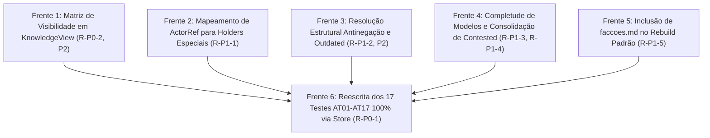

# Implementation Plan: 012 — Fase 03: Remediação Rodada 2 (G3 e Suíte de Aceite Canônica)

**Feature:** `phase-03-agents`  
**Status:** In Remediation (Plano Técnico da Rodada 2 de QA aprovado para tarefas)  
**Target:** Fase 03 do [`ROADMAP.md`](../../ROADMAP.md) e finalização do Gate G3  
**Base Analisada:**
- [`specs/012-phase-03-agents/qa-review.md`](qa-review.md) (Re-auditoria de 26/10/2026: R-P0-1, R-P0-2, R-P1-1 a R-P1-5 e P2)
- [`.tmp/probe_phase03c.py`](../../.tmp/probe_phase03c.py) e [`.tmp/probe_phase03d.py`](../../.tmp/probe_phase03d.py) (Sondas de auditoria do QA)
- [`specs/012-phase-03-agents/spec.md`](spec.md) (Requisitos atualizados FR-FIX-08 a FR-FIX-15)
- [`specs/012-phase-03-agents/g3-decision-record.md`](g3-decision-record.md) (AT01 a AT17 ratificados)

---

## 1. Arquitetura e Estratégia de Remediação (Rodada 2)

A refatoração R2 foi plenamente aprovada e os problemas de schemas v1 e determinismo básico de replay foram superados. Esta rodada ataca com foco cirúrgico as 6 frentes pendentes apontadas pelo QA:

---

## 2. Detalhamento Técnico por Frente

### Frente 1: Matriz Completa de Visibilidade em `KnowledgeView` (R-P0-2, P2-1, P2-2, P2-5)
- **Módulos:** `resources/knowledge/view.py`, `resources/knowledge/service.py`
- **Regras de Visibilidade em `query_claim(claim_id, target_holder)`:**
  1. **Distinção `inexistent` vs `unknown`:**
     - Se `claim_id` não existe nem em `claim_windows` (registrado via `knowledge.claim_registered`) nem em qualquer registro do repositório: retorna `availability="inexistent"`.
     - Se `claim_id` existe em `claim_windows` ou em outros holders, mas o `target_holder` não possui registro (e não herda): retorna `availability="unknown"`.
  2. **Matriz de Confrontação com `audience`:**
     - Se o registro possui `visibility == "player_meta"`: só é visível se `audience.kind in ("player", "human")`. Para `protagonist`, `npc` ou `faction`, **sempre** retorna `availability="unavailable"`.
     - Se o registro possui `visibility == "protagonist_private"`: só é visível se `audience.kind in ("protagonist", "player", "human")`. Para qualquer terceiro/NPC, retorna `availability="unavailable"`.
     - Se o registro possui `visibility == "holder_only"`: só é visível para o próprio holder (`audience == holder`). Para protagonista ou terceiros, retorna `availability="unavailable"`.
     - Se o registro possui `visibility == "faction_internal"`: só é visível para a própria facção ou membros afiliados leais. Para protagonista não-afiliado ou terceiros, retorna `availability="unavailable"`.
     - Se o registro possui `visibility == "subgroup_only"`: só é visível para membros do próprio subgrupo. Para a liderança geral da facção ou outros subgrupos, retorna `availability="unavailable"`.
  3. **`get_beliefs_of(holder, audience)`:**
     - Aplica a mesma matriz de visibilidade para evitar vazamento em listagens completas de crenças.
  4. **`DefaultKnowledgeProvider.build_view`:**
     - Repassar `current_time_sort` e `claim_validity_map` para `project_knowledge_state` para que `outdated` seja calculado ponta a ponta.

### Frente 2: Mapeamento Transparente de `ActorRef` para Holders Especiais (R-P1-1)
- **Módulos:** `resources/knowledge/drafts.py`
- **Mapeamento:**
  - Quando as fábricas de drafts de conhecimento (`make_knowledge_acquired_draft`, `inferred`, `revised`, `shared`) derivam o ator padrão a partir do `holder`:
    - `holder.kind == "player"` → `ActorRef(kind="human", id=holder.id)`
    - `holder.kind == "protagonist"` → `ActorRef(kind="npc", id=holder.id)`
    - `holder.kind == "subgroup"` → `ActorRef(kind="faction", id=holder.id)`
    - Se `actor` explícito for fornecido, usá-lo diretamente sem rejeição.

### Frente 3: Resolução Estrutural Antinegação e Outdated em `resolve_claim` (R-P1-2, P2)
- **Módulos:** `resources/knowledge/resolver.py`
- **Regras:**
  1. **Antinegação em `occurrence`:**
     - Eliminar verificação ingênua de substring em texto corrido.
     - Avaliar correspondência entre `claim.proposition` e os campos do payload do evento (`subject`, `action`, `predicate`, `summary`).
     - Detectar marcadores de negação explícita associados ao predicado (ex: `"não"`, `"nao"`, `"failed"`, `"impediu"`, `"rejeitou"`). Se houver negação no evento sobre o predicado, retornar `"UNKNOWN"` (não `"TRUE"`).
  2. **Janela Temporal e Estado Vigente:**
     - Se `claim.claim_type == "state"` e `claim.fact_ref` estiver definido: consultar o estado projetado. Se o estado projetado ainda reflete a alegação, o fato canônico permanece `TRUE` no presente mesmo se a janela histórica inicial tiver expirado, enquanto no período histórico é `TRUE`.

### Frente 4: Completude dos Modelos de Domínio e Consolidação de `contested` (R-P1-3, R-P1-4)
- **Módulos:** `resources/npcs/model.py`, `resources/factions/model.py`, `resources/npcs/service.py`, `resources/factions/service.py`, `resources/knowledge/service.py`
- **Completude:**
  1. `NpcState`: expor `location: Optional[str] = None`, `condition: str = "normal"`, `commitments: Tuple[str, ...] = ()`.
  2. `FactionState`: expor `collective_goals: Tuple[str, ...] = ()`, `influence: Dict[str, Any] = field(default_factory=dict)`, `limitations: Tuple[str, ...] = ()`, `internal_conflicts: Tuple[str, ...] = ()`.
  3. `project_npcs_state` e `project_factions_state`: popular e preservar todos esses campos no replay.
  4. Identidade de plano: garantir `plan_id` com prefixo `pln_` e formato estável.
  5. Consolidação de `contested`: em `project_knowledge_state`, agrupar registros por `(holder, claim_id)`. Se existirem registros separados com `supports=True` e `supports=False` para o mesmo holder/claim, o status consolidado de ambos passa para `contested` e a stance para `uncertain`.

### Frente 5: Inclusão de `faccoes.md` no Rebuild Padrão (R-P1-5)
- **Módulos:** `application/rebuild.py`
- **Ajuste:**
  - Em `default_projectors`: incluir `FactionProjector` por padrão (ou sempre que existirem eventos de facção ou inicialização de facções).
  - Garantir que `rebuild_projections` gere fisicamente `faccoes.md` e `npcs.md`.

### Frente 6: Reescrita Estrita dos 17 Testes AT01–AT17 100% via Store (R-P0-1)
- **Módulo:** `tests/test_phase03_agents_and_g3.py`
- **Requisitos de Cada Teste (1:1 com `spec.md` §4):**
  - **AT01 (Fato vs Crença):** Fato canônico (rei vivo no motor); crença do NPC no store (rei morto). O fato no motor não muda e a crença persiste no store.
  - **AT02 (Conhecer sem Acreditar):** NPC recebe informação (`awareness="known"`, `stance="disbelieved"`); intenção de agir fundamentada no fato é admitida no validador.
  - **AT03 (Proveniência Obrigatória e DAG):** Validação no store de registro com proveniência; rejeição asseriva de registro sem proveniência ou com ciclo.
  - **AT04 (Informação Falsa Sustenta Plano):** NPC crê em rumor falso; formula plano operacional aceito sem alterar o estado físico no motor.
  - **AT05 (Desatualização vs Vigência):** Informação histórica com `valid_to < current_time_sort` transiciona para `status="outdated"` sem ser perdida.
  - **AT06 (Inferência com Premissas):** Inferência baseada em premissas válidas no store é registrada com `derived_from` e nunca vira fato canônico.
  - **AT07 (Conhecimento Coletivo sem Auto-Propagação):** Membro descobre segredo da facção; demais membros e a facção não conhecem a claim sem `knowledge.shared`.
  - **AT08 (Segredo do Jogador Inacessível ao Protagonista):** Registro com `visibility="player_meta"` retorna `availability="unavailable"` quando a audiência for o protagonista.
  - **AT09 (Proposta Não Admitida Fora do Estado):** Proposta rejeitada emite `proposal.rejected` no store e seu plano fica fora do estado aceito.
  - **AT10 (Reconstrução com Correção):** Evento `correction.issued` invalida fato no motor, preservando histórico e proveniência intactos no rebuild.
  - **AT11 (Fontes Contraditórias):** Duas fontes conflitantes (`supports=True` e `supports=False`) em eventos separados consolidam status como `contested`.
  - **AT12 (Desatualizado Não é Falso na Vigência):** `resolve_claim` avalia fato com janela expirada como `FALSE` para o presente, mas válido no período histórico.
  - **AT13 (Inferência com Premissa Refutada):** Premissa refutada via `knowledge.revised` bloqueia novas inferências e mantém a inferência original histórica.
  - **AT14 (Facção Dividida e Subgrupo Dissidente):** Subgrupo com postura rebelde mantém planos com `visibility="subgroup_only"`, inacessíveis para a liderança.
  - **AT15 (Correção Não Reescreve Crença):** Correção causal via `correction.issued` não reescreve a crença subjetiva do NPC no store.
  - **AT16 (Replay e Snapshot Byte-Idêntico):** Reconstrução do zero e a partir de snapshot gera arquivos `npcs.md` e `faccoes.md` com hashes idênticos.
  - **AT17 (Matriz de Visibilidade sem Vazamentos):** `KnowledgeView` bloqueia vazamento de segredos para todas as classes de audiência não autorizadas (`holder_only`, `faction_internal`, `subgroup_only`, `player_meta`).

---

## 3. Matriz de Verificação contra as Sondas do QA

| Sonda / Seção | Comportamento Esperado | Status Planejado |
| :--- | :--- | :---: |
| `probe_phase03c.py` §1 | `player_meta` e `faction_internal` para terceiros/protagonista -> `unavailable` | Frente 1 |
| `probe_phase03c.py` §2 | `outdated` em t=300; `resolve_claim` respeitando estado atual | Frente 1 & 3 |
| `probe_phase03c.py` §3 | Registros separados de fontes opostas consolidam como `contested` | Frente 4 |
| `probe_phase03c.py` §4 | `plan_id` estável sem colisão | Frente 4 |
| `probe_phase03c.py` §5 | `NpcState` e `FactionState` com todos os campos contratuais | Frente 4 |
| `probe_phase03c.py` §6 | "O capitão não morreu" resolve como `UNKNOWN` contra `capitão morreu` | Frente 3 |
| `probe_phase03c.py` §7 | `faccoes.md gerado: True`, `npcs.md byte-idêntico: True`, hashes idênticos | Frente 5 |
| `probe_phase03d.py` | `holder_only` bloqueado para terceiros; `player`/`subgroup` aceitos nas fábricas; `unknown` para claim registrada | Frente 1 & 2 |
