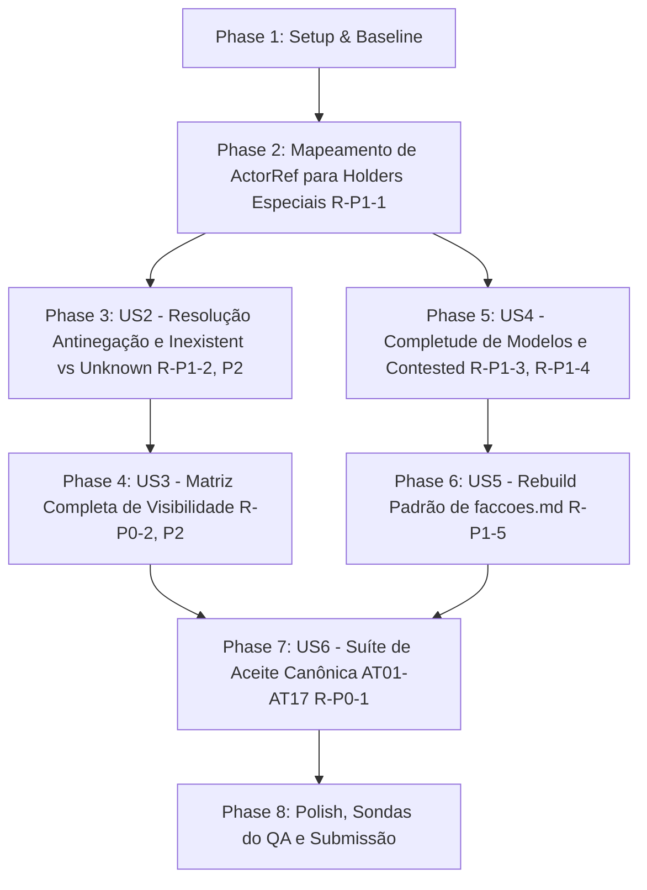

# Tasks: 012 — Fase 03: Remediação Rodada 2 (Gate G3 e Suíte de Aceite Canônica)

**Feature:** `phase-03-agents`  
**Status:** Completed (Pronto para Homologação pelo QA Independente)  
**Target:** Fase 03 do [`ROADMAP.md`](../../ROADMAP.md) e finalização do Gate G3  
**Base Analisada:**
- [`specs/012-phase-03-agents/qa-review.md`](qa-review.md) (Re-auditoria de 26/10/2026: R-P0-1, R-P0-2, R-P1-1 a R-P1-5 e P2)
- [`.tmp/probe_phase03c.py`](../../.tmp/probe_phase03c.py) e [`.tmp/probe_phase03d.py`](../../.tmp/probe_phase03d.py) (Sondas de auditoria do QA)
- [`specs/012-phase-03-agents/spec.md`](spec.md) (Requisitos atualizados FR-FIX-08 a FR-FIX-15)
- [`specs/012-phase-03-agents/plan.md`](plan.md) (Plano técnico da Rodada 2)
- [`specs/012-phase-03-agents/data-model.md`](data-model.md) (Entidades atualizadas)

---

## Dependencies & Execution Order

---

## Phase 1: Setup & Baseline de Remediação

*Goal*: Verificar estabilidade da baseline atual antes de iniciar as modificações da Rodada 2.

- [x] T001 Validar a suíte de limites arquiteturais e regressão existente executando `python -m unittest tests.test_architecture_boundaries` e `python -m unittest discover -s tests -p "test_*.py"`

---

## Phase 2: Foundational — Mapeamento de ActorRef para Holders Especiais (R-P1-1)

*Goal*: Permitir que holders especiais (`player`, `protagonist`, `subgroup`) emitam drafts válidos aceitos por `validate_draft_batch`.

- [x] T002 [P] Atualizar as fábricas de drafts em `resources/knowledge/drafts.py` para mapear transparentemente `holder.kind == "player"` para `ActorRef("human", holder.id)`, `holder.kind == "protagonist"` para `ActorRef("npc", holder.id)` ou `ActorRef("agent", "protagonist")`, e `holder.kind == "subgroup"` para `ActorRef("faction", holder.id)` no fallback de ator padrão

---

## Phase 3: User Story 2 — Resolução Estrutural Antinegação, Outdated e Inexistent vs Unknown (R-P1-2, P2)

*Goal*: Eliminar heurísticas frágeis de substring em `resolve_claim`, suportar operadores de negação, validar vigência de estado no presente vs histórico e distinguir `inexistent` de `unknown`.

- [x] T003 [P] [US2] Refatorar `resolve_claim` em `resources/knowledge/resolver.py` para comparar campos estruturados do payload (`subject`, `action`, `predicate`), detectar marcadores de negação explícita ("não", "nao", "failed", "impediu", "rejeitou") retornando `UNKNOWN`, e respeitar estado projetado vigente em claims de tipo `state` mesmo se expirada a janela temporal inicial
- [x] T004 [US2] Atualizar `project_knowledge_state` em `resources/knowledge/service.py` para receber `claim_validity_map` e `current_time_sort` de modo que claims registradas em `claim_windows` da campanha que o holder não conhece retornem `availability="unknown"` e claims fora do catálogo/janela retornem `availability="inexistent"`

---

## Phase 4: User Story 3 — Matriz Completa de Visibilidade em `KnowledgeView` (R-P0-2, P2-1, P2-2, P2-5)

*Goal*: Implementar isolamento causal e privacidade estrita para todos os escopos de visibilidade na `KnowledgeView`.

- [x] T005 [P] [US3] Atualizar `query_claim` em `resources/knowledge/view.py` para implementar a matriz estrita de visibilidade para `holder_only` (apenas `audience == holder`), `faction_internal` (apenas própria facção ou membros leais), `subgroup_only` (apenas membros do subgrupo), `protagonist_private` (apenas protagonista ou jogador) e `player_meta` (apenas jogador/humano, nunca protagonista ou NPCs)
- [x] T006 [US3] Atualizar `get_beliefs_of` em `resources/knowledge/view.py` para filtrar crenças do holder pela mesma matriz de visibilidade da audiência, impedindo vazamento em listagens completas
- [x] T007 [US3] Atualizar `DefaultKnowledgeProvider.build_view` em `resources/knowledge/view.py` para repassar `current_time_sort` e `claim_validity_map` para a projeção epistêmica subjacente

---

## Phase 5: User Story 4 — Modelos Completos de NPCs/Facções e Consolidação de `contested` (R-P1-3, R-P1-4)

*Goal*: Completar os atributos contratuais de `NpcState` e `FactionState` e consolidar status de fontes opostas inter-registros.

- [x] T008 [P] [US4] Adicionar os campos `location: Optional[str] = None`, `condition: str = "normal"` e `commitments: Tuple[str, ...] = ()` em `NpcState` em `resources/npcs/model.py`
- [x] T009 [P] [US4] Adicionar os campos `collective_goals: Tuple[str, ...] = ()`, `influence: Dict[str, Any] = field(default_factory=dict)`, `limitations: Tuple[str, ...] = ()` e `internal_conflicts: Tuple[str, ...] = ()` em `FactionState` em `resources/factions/model.py`
- [x] T010 [US4] Atualizar `project_npcs_state` em `resources/npcs/service.py` e `project_factions_state` em `resources/factions/service.py` para popular e preservar `location`, `condition`, `commitments`, `collective_goals`, `influence`, `limitations` e `internal_conflicts` durante o replay de eventos
- [x] T011 [US4] Atualizar `project_knowledge_state` em `resources/knowledge/service.py` para agrupar registros por `(holder, claim_id)` e, caso existam registros com proveniências conflitantes (`supports=True` e `supports=False`), consolidar deterministicamente o status de ambos como `contested` e a stance como `uncertain`

---

## Phase 6: User Story 5 — Inclusão de `faccoes.md` no Rebuild Padrão (R-P1-5)

*Goal*: Garantir que o projetor de facções opere por padrão no rebuild da campanha.

- [x] T012 [US5] Adicionar `FactionProjector` à lista de `default_projectors` em `application/rebuild.py` garantindo que `rebuild_projections` gere fisicamente `faccoes.md` e `npcs.md` sem depender de registro manual

---

## Phase 7: User Story 6 — Reescrita Estrita dos 17 Testes AT01–AT17 100% via Store (R-P0-1, FR-FIX-14)

*Goal*: Reconstruir a suíte de aceite para exercitar os 17 critérios exatamente conforme ratificados em `spec.md` §4, 100% gravados em `JsonlEventStore.append` e reconstruídos via `rebuild_projections`.

- [x] T013 [US6] Reescrever `tests/test_phase03_agents_and_g3.py` cobrindo exatamente os 17 critérios ratificados em `spec.md` §4 (`AT01` a `AT17`), com 100% dos testes gravando eventos via `JsonlEventStore.append` e reconstruindo estado via `rebuild_projections` sem mocks de estado em memória:
  - `test_at01_fact_vs_belief`: fato canônico (rei vivo) vs crença do NPC (rei morto); fato no motor não é alterado e crença no store persiste
  - `test_at02_knowing_without_believing`: NPC sabe que a ponte caiu (`awareness=known`, `stance=disbelieved`) e intenção de agir fundamentada no fato é admitida no validador
  - `test_at03_provenance_required_and_acyclic`: registro com proveniência e DAG é aceito; registro sem proveniência ou com ciclo é rejeitado
  - `test_at04_false_belief_drives_plan_not_fact`: crença falsa do NPC sustenta plano operacional admitido sem alterar a verdade fática do motor
  - `test_at05_outdated_distinct_from_current`: informação histórica expirada (`valid_to < current_time_sort`) transiciona deterministicamente para `status="outdated"`
  - `test_at06_provisional_inference_with_premises`: inferência exige premissas válidas com `derived_from` e nunca se promove a fato canônico consumado
  - `test_at07_collective_knowledge_no_auto_propagation`: membro de facção descobre segredo; demais membros e a facção não conhecem a claim sem `knowledge.shared`
  - `test_at08_player_secret_blocked_for_protagonist`: conhecimento com `visibility="player_meta"` retorna `availability="unavailable"` para o protagonista
  - `test_at09_rejected_proposal_leaves_state_unchanged`: proposta sem requisitos emite `proposal.rejected` e é ignorada na reconstrução do estado aceito
  - `test_at10_reconstruction_with_correction`: histórico com correção de fato (`correction.issued`) preserva integridade fática e proveniências intactas no rebuild
  - `test_at11_contradictory_sources_coexist_as_contested`: duas fontes conflitantes recebidas em eventos distintos coexistem e consolidam status como `contested`
  - `test_at12_outdated_is_not_false`: `resolve_claim` avalia estado com janela expirada como `FALSE` para o presente, mas válido no período histórico
  - `test_at13_inference_with_refuted_premise`: premissa refutada via `knowledge.revised` bloqueia novas inferências e mantém histórico
  - `test_at14_divided_faction_and_subgroup_divergence`: subgrupo dissidente mantém planos com `visibility="subgroup_only"` inacessíveis para a liderança
  - `test_at15_fact_correction_does_not_rewrite_belief`: `correction.issued` anula fato canônico no motor mas preserva crença subjetiva do NPC no store
  - `test_at16_replay_and_snapshot_byte_identical`: reconstrução do zero e a partir de snapshot gera arquivos `npcs.md` e `faccoes.md` com hashes idênticos
  - `test_at17_knowledge_view_prevents_secret_leakage`: `KnowledgeView` bloqueia vazamento de segredos para todas as classes não autorizadas (`holder_only`, `faction_internal`, `subgroup_only`, `player_meta`)

---

## Phase 8: Polish, Sondas Adversariais e Submissão ao QA

*Goal*: Validar as sondas de auditoria do QA, limites arquiteturais e suíte de regressão, registrando a remediação em `EXECUCAO.md`.

- [x] T014 Validar as sondas de auditoria do QA executando `python .tmp/probe_phase03c.py` e `python .tmp/probe_phase03d.py` e verificando que todas as asserções passam sem erros
- [x] T015 Validar os limites arquiteturais executando `python -m unittest tests.test_architecture_boundaries` comprovando módulos `< 300` linhas e fachadas `< 100` linhas
- [x] T016 Executar a suíte de regressão completa `python -m unittest discover -s tests -p "test_*.py"` garantindo 100% de testes verdes
- [x] T017 Atualizar `EXECUCAO.md` com o registro append-only da Rodada 2 (`EX-0026`) e submeter formalmente ao QA independente sem autodeclarar aprovação prévia em `ROADMAP.md` ou `ARCHITECTURE.md`
