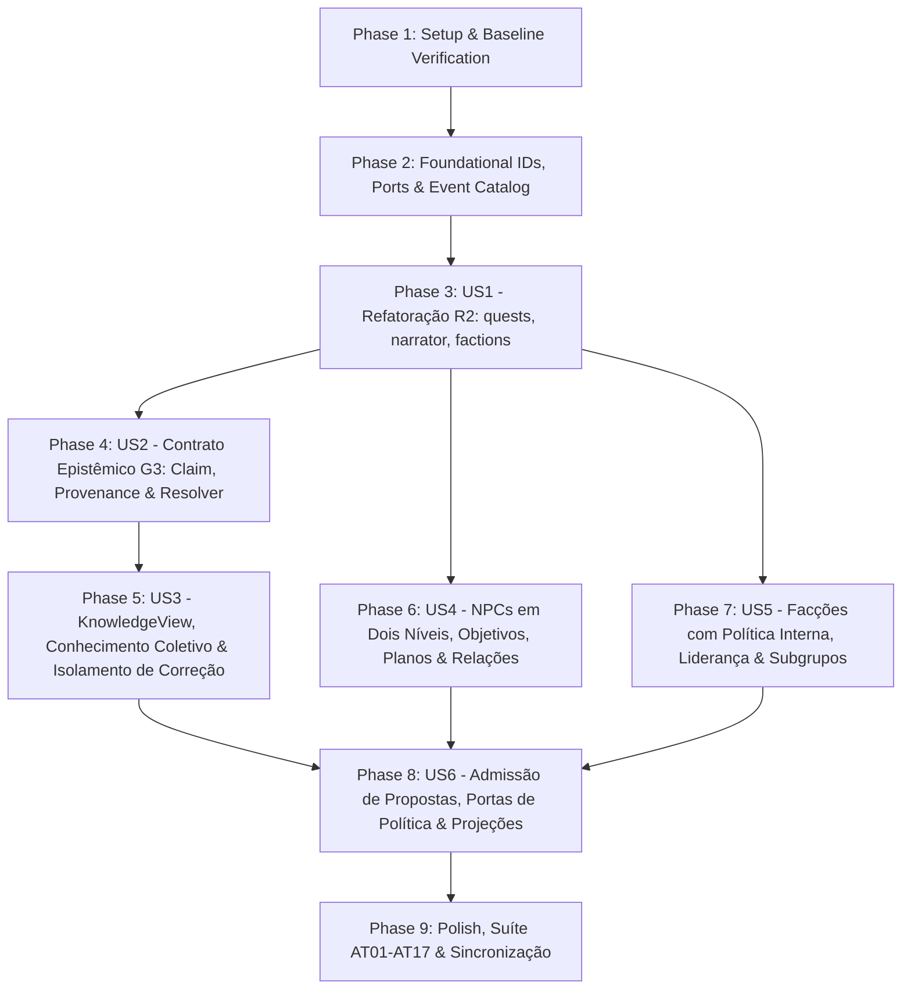

# Implementation Tasks: 012 — Fase 03: Agentes, Conhecimento Epistêmico e Refatoração R2

**Feature:** `phase-03-agents`  
**Spec:** [`spec.md`](spec.md)  
**Plan:** [`plan.md`](plan.md)  
**Research:** [`research.md`](research.md)  
**Data Model:** [`data-model.md`](data-model.md)  
**Contracts:** [`contracts/agents_and_knowledge_contracts.md`](contracts/agents_and_knowledge_contracts.md)  
**Quickstart:** [`quickstart.md`](quickstart.md)  
**Ratificação G3:** [`g3-decision-record.md`](g3-decision-record.md) e [`checklists/g3-ratification.md`](checklists/g3-ratification.md)  
**Status:** Ready for Implementation (`/speckit-implement`)

---

## Dependencies & Execution Strategy

* **MVP Scope (Incremento 1):** Phases 1 a 4 (Setup, Fundação, **US1 Refatoração R2** behavior-preserving completa e **US2 Núcleo do Contrato Epistêmico G3** com `Claim`, `ProvenanceRef`, `KnowledgeRecord` e `resolve_claim`).
* **Incremento 2:** Phases 5 a 7 (**US3 `KnowledgeView` e Conhecimento Coletivo**, **US4 NPCs em Dois Níveis** e **US5 Facções com Política Interna** — US4 e US5 podem rodar em paralelo após US1).
* **Incremento 3:** Phases 8 e 9 (**US6 Validador de Admissão, Portas `BehaviorPolicy`/`FactionPolicy`/`KnowledgeProvider`, `FactionProjector`** e **Suíte Completa `AT01`–`AT17`**).

### Parallel Execution Examples
- **Em Phase 2 (Foundational):** `T003` (`kernel/ids.py`), `T004` (`contracts/ports.py`) e `T005` (`contracts/catalog.py`) atuam em arquivos distintos e podem ser executadas em paralelo `[P]`.
- **Em Phase 3 (US1 — R2):** A extração de `resources/quests/` (`T006`–`T008`), `resources/npcs/` (`T010`–`T013`) e `resources/factions/` (`T015`–`T018`) opera em diretórios isolados e pode ser paralelizada `[P]`.
- **Entre Phase 6 (US4) e Phase 7 (US5):** Os modelos e serviços de NPCs (`resources/npcs/model.py`, `resources/npcs/service.py`) e de Facções (`resources/factions/model.py`, `resources/factions/service.py`) não possuem dependência cruzada direta e podem ser construídos em paralelo `[P]`.

---

## Phase 1: Setup & Baseline Verification

- [x] T001 Executar a suíte de testes de regressão completa (`python -m unittest discover -s tests -p "test_*.py"`) confirmando 211/211 testes verdes antes de iniciar o R2
- [x] T002 [P] Criar estrutura de pacotes com `__init__.py` para `resources/quests/`, `resources/npcs/`, `resources/factions/`, `resources/knowledge/` e `plugins/`

---

## Phase 2: Foundational Tasks (IDs, Portas & Catálogo de Eventos da Fase 03)

*Blocking Prerequisites*: Identificadores ULID (`clm_`, `knw_`, `pln_`), portas em `contracts/ports.py` e schemas dos 13 novos tipos de eventos em `contracts/catalog.py`.

- [x] T003 [P] Adicionar geradores ULID monotônicos `new_claim_id()` (`clm_<ulid>`), `new_knowledge_id()` (`knw_<ulid>`) e `new_plan_id()` (`pln_<ulid>`) em `kernel/ids.py`
- [x] T004 [P] Definir dataclasses `Intent` (`actor_kind` em `"npc" | "faction" | "subgroup"`, `intent_kind` em `"action" | "plan_step" | "goal_update" | "share_knowledge" | "conspire"`, `required_claims`, `required_capabilities`, `required_resources`), `ReactionContext`, `FactionContext` e protocolos `BehaviorPolicy`, `FactionPolicy` e `KnowledgeProvider` em `contracts/ports.py`
- [x] T005 [P] Registrar os schemas dos 13 novos eventos da Fase 03 (`knowledge.claim_registered`, `knowledge.acquired`, `knowledge.inferred`, `knowledge.revised`, `knowledge.shared`, `npc.promoted`, `npc.goal_updated`, `npc.plan_updated`, `npc.relationship_updated`, `faction.updated`, `faction.subgroup_updated`, `faction.plan_updated`, `proposal.rejected`) em `contracts/catalog.py` mantendo o arquivo `< 300` linhas

---

## Phase 3: User Story 1 — Refatoração R2: Decomposição de `quests.py`, `narrator.py` e `factions.py` (Priority: P1)

*Goal*: Cumprir a Condição 3 do Gate G3 decompondo `council/quests.py` (507 linhas), `council/narrator.py` (633 linhas) e `council/factions.py` (853 linhas) em módulos especializados `< 300` linhas dentro de `resources/`, reduzindo os módulos em `council/` a fachadas `< 100` linhas sem quebrar nenhum dos 211 testes.  
*Independent Test Criteria*: `python -m unittest discover -s tests -p "test_*.py"` passa 100% verde e `tests/test_architecture_boundaries.py` comprova que `council/quests.py`, `council/narrator.py` e `council/factions.py` têm `< 100` linhas e todos os arquivos em `resources/` têm `< 300` linhas.

- [x] T006 [P] [US1] Extrair funções de leitura e cabeçalho de missões (`parse_reward_xp`, `parse_quests_from_text`, `parse_quests_from_diario`, `format_quest_header`, `_parse_pipe_fields`, `_finalize_quest`) para `resources/quests/parser.py` (< 300 linhas)
- [x] T007 [P] [US1] Extrair funções do XP Ledger (`parse_xp_ledger_from_text`, `parse_xp_ledger_from_diario`, `append_xp_ledger_entry`) para `resources/quests/ledger.py` (< 300 linhas)
- [x] T008 [P] [US1] Extrair `upsert_quest_in_diario` e constantes (`VALID_QUEST_TYPES`, `VALID_QUEST_STATUSES`, `SECTION_HEADER`, `LEDGER_SECTION_HEADER`) para `resources/quests/mutations.py` (< 300 linhas)
- [x] T009 [US1] Reduzir `council/quests.py` a uma fachada de compatibilidade (< 100 linhas) reexportando todos os símbolos de `resources/quests/`
- [x] T010 [P] [US1] Extrair funções de parsing de NPC (`extract_md_field`, `extract_npc_bonds`, `parse_npcs_md`, `parse_npc_update_fields`, `split_npc_updates`, `_NPC_SUBFIELDS`, `_NPC_SEPARATOR_RE`, `_NPC_PIPE_RE`) para `resources/npcs/parser.py` (< 300 linhas)
- [x] T011 [P] [US1] Extrair mutações de Markdown de NPC (`upsert_npc_to_md`, `apply_npc_updates_to_md`) para `resources/npcs/mutations.py` (< 300 linhas)
- [x] T012 [P] [US1] Extrair inteligência social e iniciativa (`find_scene_relational_tensions`, `derive_npc_initiative`, `extract_epistemic_forbidden_terms`) para `resources/npcs/initiative.py` (< 300 linhas)
- [x] T013 [P] [US1] Extrair `derive_situational_scene_structures` para `resources/npcs/scene_director.py` (< 300 linhas)
- [x] T014 [US1] Reduzir `council/narrator.py` a uma fachada de compatibilidade (< 100 linhas) reexportando todos os símbolos de `resources/npcs/`
- [x] T015 [P] [US1] Extrair utilitários e parsing de facções em `mundo.md` (`REPUTATION_TIERS`, `SOCIAL_DC_MODIFIERS`, `SUGGESTED_VARIANTS`, `VALID_SCALES`, `normalize_ascii_slug`, `clamp_reputation`, `score_to_tier_name`, `legacy_label_to_score`, `parse_factions_from_mundo`, `format_faction_line`, `upsert_faction_in_mundo`) para `resources/factions/parser.py` (< 300 linhas)
- [x] T016 [P] [US1] Extrair reputação em `ficha.md` e ledger em `diario.md` (`parse_reputation_from_ficha`, `update_reputation_in_ficha`, `parse_faction_ledger_from_diario`, `append_faction_ledger_entry`) para `resources/factions/reputation.py` (< 300 linhas)
- [x] T017 [P] [US1] Extrair `simulate_faction_tick` para `resources/factions/tick.py` (< 300 linhas)
- [x] T018 [P] [US1] Extrair `resolve_scene_factions` para `resources/factions/context.py` (< 300 linhas)
- [x] T019 [US1] Reduzir `council/factions.py` a uma fachada de compatibilidade (< 100 linhas) reexportando todos os símbolos de `resources/factions/`
- [x] T020 [US1] Atualizar `tests/test_architecture_boundaries.py` para exigir `< 100` linhas em `council/quests.py`, `council/narrator.py` e `council/factions.py` e `< 300` linhas nos submódulos de `resources/`

---

## Phase 4: User Story 2 — Contrato Epistêmico G3: Alegações, Proveniência, Inferências e Resolvedor de Verdade (Priority: P1)

*Goal*: Implementar o núcleo epistêmico ratificado no Gate G3 (`G3-D01` a `G3-D05`, `G3-D10` a `G3-D12`): identidade de alegação (`Claim`), `KnowledgeRecord` determinístico, proveniência por IDs sem ciclos, inferência provisória e resolvedor determinístico de verdade do motor (`resolve_claim`).  
*Independent Test Criteria*: Cobre independentemente `AT01`, `AT02`, `AT03`, `AT06` e `AT13`: `resolve_claim` distingue fatos canônicos de crenças; `awareness` é independente de `stance`; proveniência ausente ou cíclica é rejeitada; inferências exigem premissas válidas e nunca se tornam fatos.

- [x] T021 [P] [US2] Implementar `HolderRef` (`kind` em `"npc" | "faction" | "subgroup" | "protagonist" | "player"`), `ClaimProposition`, `Claim` (`claim_id: clm_<ulid>`, `claim_type` em `"occurrence" | "state" | "prediction" | "normative" | "counterfactual"`), `ProvenanceRef` (`source_type` em `"event" | "npc" | "faction" | "document" | "inference" | "system"`, `channel` em `"observation" | "testimony" | "document" | "communication" | "inference" | "mechanism"`, `confidence` inteiro `0..10000` sem `bool`) e `KnowledgeRecord` (`record_id: knw_<ulid>`, `awareness` em `"known" | "unknown"`, `stance` em `"believed" | "disbelieved" | "uncertain"`, `status` em `"current" | "outdated" | "contested" | "refuted"`, `visibility` em `"public" | "holder_only" | "faction_internal" | "subgroup_only" | "protagonist_private" | "player_meta"`) em `resources/knowledge/model.py` (< 300 linhas)
- [x] T022 [US2] Implementar validador de proveniência e inferência (`validate_provenance_chain`, detecção de ciclos em `derived_from`, verificação de premissas existentes e bloqueio de promoção de premissa refutada a fato — `AT03`, `AT06`, `AT13`) em `resources/knowledge/provenance.py` (< 300 linhas)
- [x] T023 [US2] Implementar resolvedor determinístico de verdade do motor `resolve_claim(claim, at_time_sort, events, projected_state) -> Literal["TRUE", "FALSE", "UNKNOWN", "INDETERMINATE"]` respeitando `claim_type`, janelas `[valid_from, valid_to]` e anulações por `correction.issued` (`G3-D01`, `G3-D10`, `AT01`) em `resources/knowledge/resolver.py` (< 300 linhas)

---

## Phase 5: User Story 3 — `KnowledgeView`, Conhecimento Coletivo, Fontes Contraditórias e Isolamento de Correção (Priority: P1)

*Goal*: Implementar a projeção de estado epistêmico a partir do stream de eventos, o contrato de leitura `KnowledgeView(holder, audience, purpose)` (`G3-D06`, `G3-D07`, `G3-D14`) e a regra `G3-D15` (corrigir fato não reescreve crença automaticamente).  
*Independent Test Criteria*: Cobre `AT05`, `AT07`, `AT08`, `AT10`, `AT11`, `AT12`, `AT15` e `AT17`: duas fontes conflitantes geram `status="contested"`; `outdated` é distinguível de `refuted`; segredo de membro não propaga sem `knowledge.shared`; `KnowledgeView` bloqueia vazamento de segredo do jogador para o protagonista; `correction.issued` não altera `stance` sem `knowledge.revised`.

- [x] T024 [US3] Implementar reconstrução determinística do estado epistêmico (`project_knowledge_state`) a partir dos eventos `knowledge.claim_registered`, `knowledge.acquired`, `knowledge.inferred`, `knowledge.revised` e `knowledge.shared`, tratando coexistência de fontes contraditórias (`status="contested"` — `AT11`), transição temporal para `outdated` (`AT05`, `AT12`) e preservação de crenças diante de `correction.issued` até que ocorra `knowledge.revised` (`G3-D15`, `AT10`, `AT15`) em `resources/knowledge/service.py` (< 300 linhas)
- [x] T025 [US3] Implementar `KnowledgeView` e `ClaimQueryResult` (`availability` em `"known" | "unknown" | "unavailable" | "inexistent"`) filtrando por `holder`, `audience` e `purpose`, e implementando a porta `KnowledgeProvider` (`DefaultKnowledgeProvider`) em `resources/knowledge/view.py` (< 300 linhas)

---

## Phase 6: User Story 4 — NPCs em Dois Níveis (`minor` / `major`), Objetivos, Planos e Relações (Priority: P1)

*Goal*: Implementar o modelo de dois níveis de NPCs (`minor` simplificado e `major` detalhado com promoção via `npc.promoted`), objetivos (`short | medium | long`), planos em etapas (`PlanStep`), recursos, capacidades e matriz relacional (`RelationalVector`).  
*Independent Test Criteria*: Um NPC `minor` pode ser promovido a `major` preservando vínculos e histórico; objetivos, planos em etapas e relações dimensionais (`trust`, `rivalry`, `dependency`, `debt`, `loyalty` em `-3..+3`) são reconstruídos deterministicamente a partir do event log.

- [x] T026 [P] [US4] Implementar dataclasses imutáveis `RelationalVector` (`trust`, `rivalry`, `dependency`, `debt`, `loyalty`), `AgentGoal` (`horizon` em `"short" | "medium" | "long"`, `priority` `1..5`, `status` em `"active" | "completed" | "abandoned" | "blocked"`), `PlanStep` (`status` em `"pending" | "in_progress" | "completed" | "failed" | "blocked"`), `AgentPlan` (`plan_id: pln_<ulid>`, `status` em `"proposed" | "active" | "completed" | "interrupted" | "abandoned"`) e `NpcState` (`tier` em `"minor" | "major"`) em `resources/npcs/model.py` (< 300 linhas)
- [x] T027 [US4] Implementar serviço de domínio de NPCs (`promote_npc_draft`, `update_npc_goal_draft`, `update_npc_plan_draft`, `update_npc_relationship_draft` e `project_npcs_state` a partir do stream de eventos) em `resources/npcs/service.py` (< 300 linhas)

---

## Phase 7: User Story 5 — Facções com Política Interna, Liderança, Subgrupos e Conspirações (Priority: P1)

*Goal*: Modelar facções com objetivos coletivos, planos, liderança, autoridade, sucessão, subgrupos (`aligned | divergent | conspiring`) e divergências internas (`AT14`).  
*Independent Test Criteria*: Uma facção não opera como opinião única: subgrupos mantêm agendas próprias, compartilhamento restrito à liderança/subgrupo não vaza automaticamente para subgrupos dissidentes (`AT14`), e todo o estado é reconstruível por replay.

- [x] T028 [P] [US5] Implementar dataclasses imutáveis `FactionLeadership` (`leader_id`, `authority_rules`, `succession_line`), `FactionSubgroup` (`subgroup_id`, `leader_id`, `stance_towards_leadership` em `"aligned" | "divergent" | "conspiring"`, `agenda`, `members`, `resources`) e `FactionState` em `resources/factions/model.py` (< 300 linhas)
- [x] T029 [US5] Implementar serviço de domínio de facções (`update_faction_draft`, `update_subgroup_draft`, `update_faction_plan_draft`, validação de autoridade de liderança e `project_factions_state` a partir do stream de eventos) em `resources/factions/service.py` (< 300 linhas)

---

## Phase 8: User Story 6 — Admissão de Propostas, Portas de Política e Projeções (`npcs.md` e `faccoes.md`) (Priority: P1)

*Goal*: Implementar o validador de admissão de propostas (`G3-D08`, `G3-D09`), as políticas determinísticas padrão (`BehaviorPolicy`, `FactionPolicy`), a projeção `faccoes.md` e a extensão de `npcs.md` com suporte a replay e snapshot-cache (`G3-D13`, `AT04`, `AT09`, `AT16`).  
*Independent Test Criteria*: Propostas baseadas em fatos desconhecidos, sem recursos/capacidades ou sem autoridade de facção são rejeitadas (`AdmissionResult.admitted == False`) e ignoradas no replay (`AT09`); crenças falsas conhecidas sustentam planos operacionais sem alterar fatos canônicos (`AT04`); rebuild do zero e de snapshot gera `npcs.md` e `faccoes.md` byte-idênticos (`AT16`).

- [x] T030 [US6] Implementar `AdmissionResult`, `validate_intent_admission` (verificando `awareness == "known"` em `required_claims`, `required_capabilities`, `required_resources`, condição/localização e autoridade de facção) e `build_rejected_proposal_draft` (`proposal.rejected`) em `resources/admission.py` (< 300 linhas)
- [x] T031 [P] [US6] Implementar `UtilityBehaviorPolicy` (`name="utility_v1"`, `BehaviorPolicy`) e `StrategicFactionPolicy` (`name="strategic_v1"`, `FactionPolicy`) puras e determinísticas (sem I/O) em `plugins/agent_policies.py` (< 300 linhas)
- [x] T032 [US6] Registrar `UtilityBehaviorPolicy`, `StrategicFactionPolicy`, `DefaultKnowledgeProvider` e os novos `EventType`s da Fase 03 em `bootstrap.py`
- [x] T033 [P] [US6] Atualizar `application/projectors/npc.py` (< 300 linhas) para renderizar deterministicamente campos de NPCs `major` (objetivos, planos, relações, recursos e status de promoção) preservando 100% do formato das campanhas sem eventos `npc.promoted`
- [x] T034 [P] [US6] Implementar `FactionProjector` (`file="faccoes.md"`, `order=40`) em `application/projectors/faction.py` (< 300 linhas) e integrá-lo opcionalmente em `application/projectors/engine.py` e `application/rebuild.py` (com suporte a snapshot-cache `G3-D13`)

---

## Phase 9: Polish, Suíte de Aceite AT01–AT17 & Sincronização Documental

*Goal*: Validar os 17 critérios de aceitação ratificados no Gate G3 (`AT01`–`AT17`), os limites arquiteturais de linhas e importações AST, e sincronizar a documentação canônica.  
*Independent Test Criteria*: Todos os 17 testes `AT01`–`AT17` e todos os 211 testes anteriores passam com `OK`; `test_architecture_boundaries.py` passa sem ressalvas.

- [x] T035 Criar a suíte automatizada `tests/test_phase03_agents_and_g3.py` implementando testes determinísticos explícitos para todos os 17 critérios (`AT01` a `AT17`) e para os contratos de `BehaviorPolicy`, `FactionPolicy` e `KnowledgeProvider`
- [x] T036 Atualizar `tests/test_architecture_boundaries.py` adicionando todos os novos módulos (`resources/knowledge/*`, `resources/npcs/*`, `resources/factions/*`, `resources/quests/*`, `resources/admission.py`, `plugins/agent_policies.py`, `application/projectors/faction.py`) ao controle de fronteiras AST (proibindo I/O em `plugins/`) e ao limite estrito `< 300` linhas
- [x] T037 Executar a suíte completa (`python -m unittest discover -s tests -p "test_*.py"`) e `python -m unittest tests.test_architecture_boundaries` comprovando zero falhas e zero avisos
- [x] T038 Atualizar `specs/012-phase-03-agents/checklists/g3-ratification.md`, `ROADMAP.md`, `ARCHITECTURE.md` e registrar a execução em `EXECUCAO.md` (durante `/speckit-implement`)
