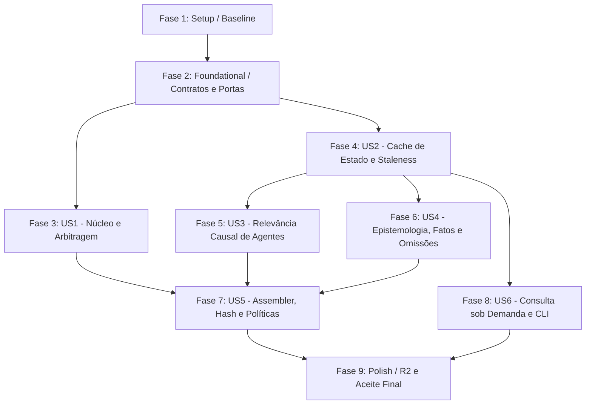

# Implementation Tasks: 013 — Fase 04: Contexto Causal no `prepare`

**Feature:** `phase-04-causal-context`  
**Spec:** [`spec.md`](spec.md) · **Plan:** [`plan.md`](plan.md) · **Research:** [`research.md`](research.md) · **Data model:** [`data-model.md`](data-model.md) · **Contracts:** [`contracts/context_contracts.md`](contracts/context_contracts.md)  
**Status:** Pronto para implementação (`/speckit-implement`)  
**Baseline:** 234 testes verdes; `application/prepare.py` 475 linhas

---

## Dependências e Sequenciamento

- **Caminho Crítico:** Setup → Foundational → US2 (Cache) → US3 (Relevância) → US5 (Assembler) → Polish.
- **Oportunidades de Paralelismo [P]:**
  - Tarefas de contratos, modelos e portas em Foundational (T002, T003, T004, T005).
  - Extração de mecânica (US1: T006) e implementação do projector (US2: T009).
  - Provedores de agentes (US3: T012, T013) e provedores epistêmicos/fatos (US4: T015, T016).

---

## Fase 1: Setup

*Objetivo da Fase:* Estabelecer baseline reprodutível e registrar métricas antes de qualquer alteração de código.

- [X] T001 Executar a suíte de testes legada `python -m unittest discover -s tests -p "test_*.py"` e as fronteiras arquiteturais `python -m unittest tests.test_architecture_boundaries`, registrando 234 testes verdes e as linhas atuais de `application/prepare.py` (475 linhas).

---

## Fase 2: Foundational (Bloqueante para todas as histórias)

*Objetivo da Fase:* Estabelecer os contratos, protocolos puros e estruturas de dados compartilhadas sem dependências de I/O ou chamadas externas.

- [X] T002 [P] Implementar dataclasses imutáveis em `contracts/context.py` com `ContextScene`, `ContextRequest`, `ContextLimits` (max_npcs=5, max_factions=3, max_facts=8, max_consequences=5, min_relevance=200), `ContextItem`, `ContextOmission`, `ContextSection`, `TurnContext` e `ContextQueryResult`.
- [X] T003 [P] Adicionar os protocolos `ContextProvider` (`key: str`, `layer: str`, `priority: int`, `provide(request, state) -> ContextSection`) e `ContextStateView` (`last_seq`, `stale`, `npcs()`, `factions()`, `knowledge()`, `recent_events()`, `quests()`, `clocks()`, `arc()`) em `contracts/ports.py`.
- [X] T004 [P] Criar enums e validações de modelo puro em `resources/context/model.py` com `ContextLayer` (`core`, `causal`), `Availability` (`known`, `unknown`, `unavailable`, `inexistent`) e `ContextKind`.
- [X] T005 [P] Implementar algoritmo puro de relevância causal em `resources/context/relevance.py` com funções `score_npc`, `score_faction` e `select`, aplicando tabela de pesos inteiros (+1000 presença, +500 foco, +300 relógio crítico, +300 plano ativo, +250 missão, +200 arco, +200 rivalidade, +150 dívida, +100 consequência, −100 fora da cena; limiar 200) e ordenação determinística por `(-score, kind, id)`.

---

## Fase 3: User Story 1 (P1) — Núcleo Obrigatório e Arbitragem Mecânica

*Objetivo da História (US1):* Isolar a resolução mecânica de rolagens e disputas, extrair provedores do núcleo obrigatório e garantir que o payload legado permaneça byte-compatível.  
*Critério de Teste Independente:* Executar `tests/test_boundary_contracts.py` e verificar aprovação contínua do snapshot de contrato de `prepare`.

- [X] T006 [P] [US1] Extrair a lógica de resolução mecânica (needs_roll, contest PC×NPC/NPC×NPC, rolagens d20/Fudge, custos e críticos) de `application/prepare.py` para `application/arbitration.py` com a assinatura `resolve_arbitration(action, campaign, ficha_data, npcs_data, no_roll=False) -> ArbitrationResult`.
- [X] T007 [P] [US1] Implementar provedores de núcleo em `application/context/providers.py` para `ruleset_core` (prioridade 10), `protagonist_core` (prioridade 20) e `scene_core` (prioridade 30), reutilizando os parsers Markdown existentes sem criar novos parsers.
- [X] T008 [US1] Implementar provedores causais de estrutura em `application/context/providers.py` para `quest_causal` (prioridade 40; missões ativas, objetivos pendentes, pressão) e `clock_causal` (prioridade 45; relógios ativos e críticos).

---

## Fase 4: User Story 2 (P1) — Cache de Estado Derivado e Staleness

*Objetivo da História (US2):* Gerar e gerenciar a projeção `estado.json` a partir do histórico de eventos, evitando re-execuções sequenciais do event store e tratando divergências de versão.  
*Critério de Teste Independente:* Verificar que com cache fresco `prepare` não chama `EventStore.read`, e que cache stale/removido é reconstruído automaticamente com `stale=true` registrado.

- [X] T009 [P] [US2] Implementar projector `StateProjector` em `application/projectors/state.py` (`order=50`, `file="estado.json"`) projetando `npcs`, `factions`, `knowledge` e `recent_events` em JSON canônico com `schema_version=1`, `last_seq` e hash, registrando-o em `application/projectors/__init__.py`.
- [X] T010 [US2] Implementar leitor de estado derivado em `application/context/state.py` com classe `ContextStateViewImpl` que carrega `estado.json`, compara `last_seq` com `store.last_seq(campaign_id)`, dispara `rebuild_projections(emit_audit_event=False)` em caso de divergência ou ausência, e emite `PrepareError` explícito se a reconstrução falhar.
- [X] T011 [US2] Integrar a gravação de `estado.json` ao ciclo de commit em `application/transaction.py` e à CLI em `application/rebuild.py`, garantindo paridade absoluta com as projeções Markdown.

---

## Fase 5: User Story 3 (P1) — Relevância Causal de Agentes e Antagonistas Distantes

*Objetivo da História (US3):* Selecionar NPCs e facções por impacto causal real na cena (planos iminentes, ameaças, relógios, alianças) e não apenas por presença física local.  
*Critério de Teste Independente:* Antagonista distante com plano ativo ou relógio crítico deve entrar em `causal.items` com `score > 0` e `reasons` explicadas (C02); NPC presente sem impacto causal não entra em `causal.items` (C03).

- [X] T012 [P] [US3] Implementar provedor de NPCs causais `npc_causal` em `application/context/agents.py` (prioridade 50) pontuando NPCs presentes e distantes através de `score_npc`, anexando `score` e lista explicativa `reasons` a cada `ContextItem`.
- [X] T013 [P] [US3] Implementar provedor de facções causais `faction_causal` em `application/context/agents.py` (prioridade 55) pontuando facções através de `score_faction` por planos corporativos, rivalidades, reputação e relógios vinculados.
- [X] T014 [US3] Integrar a seleção de topo e descarte de agentes em `resources/context/relevance.py` e `application/context/assembler.py`, garantindo que presentes abaixo do limiar vão para `background_cast` e descartados por limite gerem omissões `below_threshold`.

---

## Fase 6: User Story 4 (P1) — Barreira Epistêmica, Fatos e Classificação de Omissões

*Objetivo da História (US4):* Proteger o sigilo epistêmico entre audiências, filtrar fatos e correções recentes, e classificar formalmente toda lacuna referenciada para impedir alucinação ou invenção de fatos pela IA.  
*Critério de Teste Independente:* Testar que `player_meta` nunca vaza para `protagonist`/`narrator`/`writer` (C04), fatos corrigidos viram consequências e não fatos vigentes (C05), e referências ausentes geram omissões explícitas (`unknown`, `unavailable`, `inexistent`) (C06).

- [X] T015 [P] [US4] Implementar provedor de conhecimento `knowledge_causal` em `application/context/knowledge.py` (prioridade 60) integrando com `KnowledgeView` da Fase 03, garantindo isolamento estrito de `player_meta` e claims de terceiros conforme a audiência ativa.
- [X] T016 [P] [US4] Implementar provedor de fatos e consequências `facts_causal` em `application/context/knowledge.py` (prioridade 65) identificando eventos recentes válidos, rebaixando fatos alterados por `correction.issued` para consequências e respeitando os limites `max_facts` e `max_consequences`.
- [X] T017 [US4] Implementar coletor determinístico de omissões em `application/context/assembler.py`, classificando toda entidade ou claim citada na ação ou foco como `inexistent` (se não cadastrada), `unavailable` (se existente mas fora da visibilidade do holder) ou `unknown` (se visível mas não crida).

---

## Fase 7: User Story 5 (P2) — Assembler de Contexto, Políticas por Modo e Payload Aditivo

*Objetivo da História (US5):* Montar as três camadas (`core`, `causal`, `query`), calcular `context_hash` determinístico e compor o payload de retorno sem alterar as chaves legadas do motor.  
*Critério de Teste Independente:* Duas execuções idênticas devem produzir hashes SHA-256 rigorosamente iguais (C01/C09); políticas por modo (`gm`, `narrator`, `writer`, `architect`, `director`, `reviewer`) devem aplicar as audiências e visibilidades especificadas (C10).

- [X] T018 [US5] Implementar o montador central `ContextAssembler` em `application/context/assembler.py` que executa os provedores ordenados por prioridade, aplica filtros de camada, calcula o SHA-256 canônico `context_hash` e monta as seções `core`, `causal` e `omissions`.
- [X] T019 [US5] Implementar resolução de políticas por modo em `resources/context/policy.py`, derivando `viewer`, `audience` e `purpose` a partir de `mode` (`gm` → universo/arbitragem, `narrator`/`writer` → protagonista/narração, `architect`/`director` → autor/estrutura, `reviewer` → auditoria sem contexto novo) com override via flag `--audience`.
- [X] T020 [US5] Atualizar `application/prepare.py` para invocar `ContextAssembler`, manter `step_1_*` até `step_4_*` derivados e injetar as chaves aditivas `context_version`, `context`, `context_omissions` e `source_last_seq`.

---

## Fase 8: User Story 6 (P2) — Consulta sob Demanda via Serviço e CLI

*Objetivo da História (US6):* Permitir inspeção ad-hoc de entidades e crenças no estado persistente respeitando a mesma matriz de visibilidade epistêmica.  
*Critério de Teste Independente:* Executar comandos de consulta para claim, npc, faction, quest e clock via CLI e validar saída JSON determinística com availability explícita (C07).

- [X] T021 [P] [US6] Implementar o serviço de consulta `ContextQueryService` em `application/context/query.py` com métodos `claim()`, `npc()`, `faction()`, `quest()` e `clock()`, reutilizando `KnowledgeView` e o cache sem persistir eventos.
- [X] T022 [US6] Adicionar o subcomando `query` à interface de linha de comando em `interfaces/cli/parser.py` e `interfaces/cli/main.py` com argumentos `--campaign`, `--kind`, `--id`, `--audience` e flag `--json`.

---

## Fase 9: Polish & Cross-Cutting Concerns (R2, Limites e Fechamento)

*Objetivo da Fase:* Garantir conformidade com os limites estritos de código (`prepare.py < 300` linhas), fronteiras arquiteturais AST, execução da suíte C01–C10 e registro de execução.

- [X] T023 [P] Refatorar `application/prepare.py` para ter menos de 300 linhas, assegurar que todos os novos arquivos em `application/context/*` e `resources/context/*` tenham `< 300` linhas, e incluir os novos arquivos nos alvos estritos de `tests/test_architecture_boundaries.py`.
- [X] T024 Criar a suíte completa de testes de aceite C01 a C10 em `tests/test_phase04_causal_context.py` usando `JsonlEventStore` e fixtures isoladas.
- [X] T025 Criar a suíte de testes de cache e staleness em `tests/test_phase04_state_cache.py`, incluindo teste instrumentado com stub que comprova a ausência de chamadas a `EventStore.read` quando o cache está fresco.
- [X] T026 Executar a suíte de testes de regressão completa (234 legados + novos testes de contexto), validar o guia [`quickstart.md`](quickstart.md) e verificar conformidade no snapshot de contrato.
- [X] T027 Registrar a entrega da Fase 04 em [`EXECUCAO.md`](../../EXECUCAO.md) com evidências de teste e atualizar status no [`ROADMAP.md`](../../ROADMAP.md).

---

## Resumo e Métricas do Desdobramento

| Métrica | Valor |
| :--- | :--- |
| **Total de Tarefas** | 27 tarefas (T001 a T027) |
| **Setup & Foundational** | 5 tarefas (T001 a T005) |
| **US1 (Núcleo & Arbitragem)** | 3 tarefas (T006 a T008) |
| **US2 (Cache & Staleness)** | 3 tarefas (T009 a T011) |
| **US3 (Relevância Causal)** | 3 tarefas (T012 a T014) |
| **US4 (Epistemologia & Omissões)** | 3 tarefas (T015 a T017) |
| **US5 (Assembler & Payload)** | 3 tarefas (T018 a T020) |
| **US6 (Consulta & CLI)** | 2 tarefas (T021 a T022) |
| **Polish, R2 & Aceite** | 5 tarefas (T023 a T027) |
| **Tarefas Paralelizáveis [P]** | 10 tarefas identificadas |
| **Escopo MVP Recomendado** | Fases 1 a 4 (Setup, Foundational, US1 e US2) |
