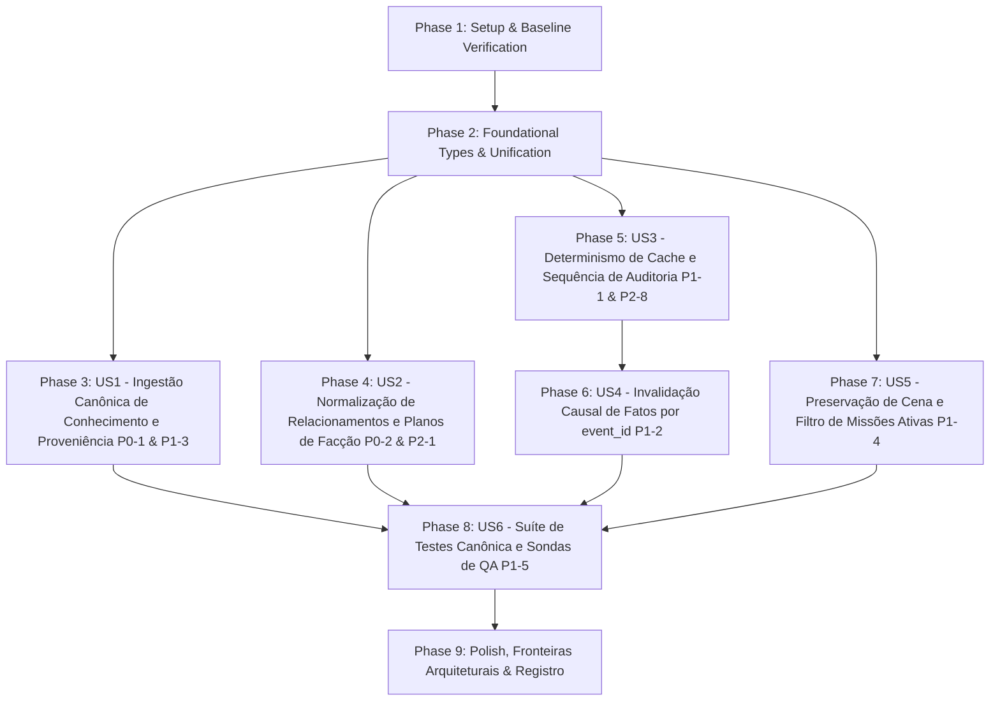

# Implementation Tasks: 014 — Remediação dos Bloqueantes de QA da Fase 04

**Feature**: `fix-phase-04-qa-review`  
**Spec**: [`spec.md`](spec.md)  
**Plan**: [`plan.md`](plan.md)  
**Research**: [`research.md`](research.md)  
**Data Model**: [`data-model.md`](data-model.md)  
**Contracts**: [`contracts/remediation_contracts.md`](contracts/remediation_contracts.md)  
**Quickstart**: [`quickstart.md`](quickstart.md)  
**Status**: Ready for execution  

---

## Dependencies & Execution Strategy

* **MVP Scope**: Phases 1 a 4 (`US1` Ingestão de Conhecimento com Proveniência [P0-1/P1-3] e `US2` Normalização de Relacionamentos de NPCs [P0-2]).
* **Incremento 2**: Phases 5 a 7 (`US3` Determinismo de Cache sem loop de staleness [P1-1/P2-8], `US4` Invalidação Causal por `event_id` [P1-2] e `US5` Preservação de Atores de Cena e Filtro de Missões [P1-4]).
* **Incremento 3**: Phases 8 e 9 (`US6` Suíte de testes com dados canônicos e sondas adversariais [P1-5] e Polish/Fronteiras arquiteturais).

---

## Phase 1: Setup & Baseline Verification

- [X] T001 Executar a suíte de testes de baseline com `python -m unittest discover -s tests -p "test_*.py"` e confirmar os 249 testes passando antes de iniciar as alterações

---

## Phase 2: Foundational Types & Unification

- [X] T002 Unificar `HolderRef` em `contracts/context.py` adicionando a validação de `VALID_HOLDER_KINDS = {"npc", "faction", "subgroup", "protagonist", "player"}` e validação de `id` não vazio
- [X] T003 Reexportar `HolderRef` de `contracts.context` dentro de `resources/knowledge/model.py`, garantindo que não existam classes duplicadas e que `contracts/` permaneça livre de imports de `resources/`

---

## Phase 3: User Story 1 — Ingestão Canônica de Conhecimento e Proveniência (P0-1 & P1-3)

*Goal*: Deserializar registros de conhecimento com a assinatura canônica de `ProvenanceRef` (6 campos) sem engolir exceções com `except Exception: return None`, unificando a consulta de claims conhecidas pelo protagonista.  
*Independent Test Criteria*: Registrar evento `knowledge.acquired` contendo `provenance` completo; verificar que `prepare` e `query claim` localizam a alegação como `known` sem retorno `None` e que `--audience protagonist` resolve para o herói da campanha.

- [X] T004 [US1] Refatorar `_dict_to_knowledge_record` em `application/context/knowledge.py` para instanciar `ProvenanceRef` com `source_type`, `source_id`, `channel`, `acquired_at`, `acquired_at_sort`, `confidence` (e `derived_from`, `supports`), mapeando `awareness="known"` e `stance="believed"` por padrão
- [X] T005 [US1] Remover a cláusula cega `except Exception: return None` em `application/context/knowledge.py`, permitindo que erros de validação sejam rastreáveis e não descartem silenciosamente o conhecimento
- [X] T006 [US1] Atualizar `ContextQueryService` em `application/context/query.py` e o despacho CLI em `interfaces/cli/main.py` para resolver a audiência `protagonist` a partir do nome real do protagonista em `ficha.md` quando o id for padrão

---

## Phase 4: User Story 2 — Normalização de Relacionamentos e Planos de Facção (P0-2 & P2-1)

*Goal*: Tornar o cálculo de relevância de NPCs imune a erros de tipo quando `relationships` for `list[dict]` ou `dict`, e reconhecer a chave `active_plan` para pontuar planos iminentes de facção.  
*Independent Test Criteria*: Executar `score_npc` sobre NPC com `relationships` serializado como lista de dicionários com `rivalry: 2` e verificar que o score recebe `+200` com justificativa `ameaca` sem levantar `AttributeError`; verificar que `score_faction` concede `+300` com justificativa `plano_iminente` quando `active_plan` existir.

- [X] T007 [P] [US2] Implementar a função pura `_extract_relational_vector(npc_data, target_id="")` em `resources/context/relevance.py` tolerando `relationships` como `list[dict]` ou `dict` e buscando o vetor relacional com o alvo solicitado
- [X] T008 [US2] Atualizar a pontuação de ameaça e dívida de NPCs em `score_npc` dentro de `resources/context/relevance.py` para consumir o dicionário retornado por `_extract_relational_vector`
- [X] T009 [P] [US2] Atualizar `score_faction` em `resources/context/relevance.py` para inspecionar `active_plan` além de `plan` e `initiative`

---

## Phase 5: User Story 3 — Determinismo de Cache e Sequência de Auditoria (P1-1 & P2-8)

*Goal*: Sincronizar a sequência de log do `estado.json` após emissão de `projection.rebuilt`, eliminando o loop de staleness em chamadas sucessivas de `prepare`, e validar `schema_version`.  
*Independent Test Criteria*: Executar `rebuild_projections(store, campaign_id, campaign_dir, emit_audit_event=True)` seguido de `ContextStateViewImpl.load(...)` e verificar que `view.stale` é `False` e que nenhum rebuild recursivo é disparado.

- [X] T010 [US3] Atualizar `StateProjector` em `application/projectors/state.py` para registrar `last_seq = view.last_seq` (ou `base_last_seq or view.last_seq`) mantendo o número do fluxo total processado
- [X] T011 [US3] Atualizar `rebuild_projections` em `application/rebuild.py` para atualizar o campo `last_seq` no arquivo `estado.json` em disco após o append do evento `projection.rebuilt`
- [X] T012 [US3] Atualizar `ContextStateViewImpl.load` em `application/context/state.py` para validar `schema_version == 1` e tolerar que `cached_seq < expected_seq` quando os eventos intermediários forem exclusivamente eventos técnicos (`projection.*`)

---

## Phase 6: User Story 4 — Invalidação Causal de Fatos por `event_id` (P1-2)

*Goal*: Anular fatos contraditos ou retificados por correções emitidas que referenciam o identificador do evento no campo `corrects` (`evt_<ulid>`), indexando `event_id` nos eventos recentes.  
*Independent Test Criteria*: Emitir uma correção com `corrects: ["evt_01J..."]` referente ao evento de um turno anterior; verificar que o fato correspondente é omitido da seção de fatos vigentes do `prepare`.

- [X] T013 [US4] Atualizar a projeção de `new_recent` em `application/projectors/state.py` para incluir a chave `"event_id": getattr(ev, "id", "")` em cada item de `recent_events`
- [X] T014 [US4] Atualizar `FactsCausalProvider` em `application/context/knowledge.py` para aceitar identificadores de evento do tipo string (`evt_<ulid>`) e inteiros em `corrects`, excluindo fatos cujo `event_id` ou `seq` coincida com eventos corrigidos

---

## Phase 7: User Story 5 — Preservação de Cena e Filtro de Missões Ativas (P1-4)

*Goal*: Restaurar o comportamento legado da seleção de atores focais e restringir o mandato de pressão de missões estritamente a missões com status ativo.  
*Independent Test Criteria*: Em uma cena com 2 NPCs presentes sem vontade/plano preenchido, verificar que ambos são selecionados como atores focais; em uma campanha com missão concluída, verificar que a missão concluída não aparece no `quest_pressure_mandate`.

- [X] T015 [P] [US5] Restaurar o fallback de seleção de até os 2 primeiros NPCs presentes na cena (`scene_npcs[:2]`) em `resolve_scene_actors` dentro de `application/context/scene.py`
- [X] T016 [P] [US5] Filtrar missões com `status == "ACTIVE"` em `build_quest_context` dentro de `application/context/scene.py` antes de eleger o objetivo para `quest_pressure_mandate`

---

## Phase 8: User Story 6 — Suíte de Testes Canônica e Sondas de QA (P1-5)

*Goal*: Substituir todas as fixtures artificiais por eventos canônicos com proveniência e `event_id`, garantindo que os 10 critérios C01–C10 sejam testados contra os caminhos reais do motor.  
*Independent Test Criteria*: `tests/test_phase04_causal_context.py` e `tests/test_phase04_state_cache.py` passam sem fixtures sintéticas e as sondas adversariais `probe_phase04.py` e `probe_phase04b.py` executam com sucesso.

- [X] T017 [US6] Atualizar o setup de testes em `tests/test_phase04_causal_context.py` para emitir `knowledge.acquired` com `ProvenanceRef` canônica e configurar relacionamentos em lista de dicionários
- [X] T018 [US6] Atualizar o teste `test_c05_facts_and_corrections` em `tests/test_phase04_causal_context.py` para utilizar `event_id` no campo `corrects` da correção
- [X] T019 [US6] Atualizar `tests/test_phase04_state_cache.py` para validar o ciclo de rebuild com `emit_audit_event=True` e verificar que `stale == False`
- [X] T020 [US6] Executar o script de validação adversarial rápida baseado em `quickstart.md` confirmando a passagem de todos os fluxos remediados

---

## Phase 9: Polish, Fronteiras Arquiteturais & Registro

- [X] T021 Verificar os limites estritos de 300 linhas por arquivo executando `python -m unittest tests/test_architecture_boundaries.py`
- [X] T022 Executar a suíte de testes integral do projeto (`python -m unittest discover -s tests -p "test_*.py"`) assegurando 250+ testes verdes
- [X] T023 Registrar a execução da remediação da Fase 04 em `EXECUCAO.md` e atualizar o status em `specs/013-phase-04-causal-context/qa-review.md` e `ROADMAP.md`
