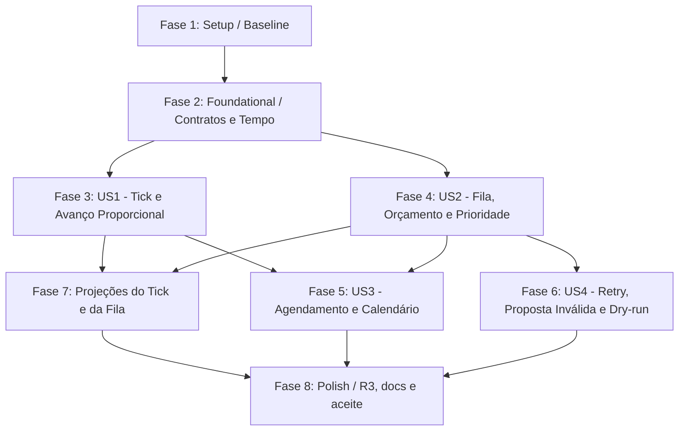

# Implementation Tasks: 015 — Fase 05: Simulação de Mundo por Tempo

**Feature:** `phase-05-simulation`
**Spec:** [`spec.md`](spec.md) · **Plan:** [`plan.md`](plan.md) · **Gate:** [`g4-decision-record.md`](g4-decision-record.md) · **Contracts:** [`contracts/p5-simulation-contracts.md`](contracts/p5-simulation-contracts.md)
**Status:** Pronto para implementação (`/speckit-implement`)
**Baseline:** 250 testes verdes; `lazy_turn.py` 54 linhas; `application/prepare.py` 287 linhas

---

## Dependências e Sequenciamento

- **Caminho Crítico:** Setup → Foundational → US1 → US2 → Projeções → Polish.
- **Paralelismo [P]:** contratos e tempo (T002–T005); políticas puras (T008, T009); projeção (T013) independente da CLI.

---

## Fase 1: Setup

*Objetivo:* baseline reprodutível antes de qualquer código.

- [X] T001 Executar `python -m unittest discover -s tests -p "test_*.py"` (250 verdes) e `tests.test_architecture_boundaries`, registrando linhas atuais de `main.py`, `prepare.py` e `catalog.py`.

---

## Fase 2: Foundational (Bloqueante)

- [X] T002 [P] Criar `contracts/simulation.py`: `WorkKind`, `WorkStatus`, `WorkItem`, `TickBudget`, `TickRequest`, `WorldView`, `TickDecision`, `WorkOutcome` e protocolos `SimulationPolicy`/`BudgetPolicy`, imutáveis, com validação de campos e serialização canônica.
- [X] T003 [P] Adicionar em `contracts/catalog.py` os 5 schemas `world.ticked`, `world.scheduled`, `world.work_deferred`, `world.work_completed`, `world.work_failed` (v1, sem upcaster).
- [X] T004 [P] Implementar em `temporal/calendar.py` `minutes_to_game_time(total_minutes, template, calendar)` e `advance_game_time(dt_str, minutes, calendar)` com ida-e-volta para `Dia N`, `DD/MM/AAAA` e `D de Mês de AAAA`, respeitando o calendário declarado.
- [X] T005 [P] Estender `campaign/locator.py` para expor `simulation` (cadências, orçamento, retry) com defaults conservadores; criar `resources/world/config.py` com normalização e validação.

---

## Fase 3: US1 (P1) — Tick e Avanço Proporcional

*Objetivo:* `world_tick` avança tempo, relógios e planos determinicamente, sem inventar desfecho.

- [X] T006 [US1] Implementar `resources/world/cadence.py` (deltas proporcionais, saturação de relógio, progressão de passos, `plan_ready_for_resolution`).
- [X] T007 [US1] Implementar `resources/world/ids.py` (`work_id`, `tick_id`, chave canônica de payload).
- [X] T008 [P] [US1] Implementar `resources/world/resolve.py`: resolução pura por `kind` → `(drafts, outcome)` ou `(error, retry_at_sort)`.
- [X] T009 [US1] Implementar `plugins/simulation_policy.py` (`TimedSimulationPolicy.due(view)`) e `plugins/budget_policy.py` (`PriorityBudgetPolicy.select`), puros e sem I/O.
- [X] T010 [US1] Implementar `application/world_tick.py` com transação, lote único, rebuild, relatório e `--dry-run`.
- [X] T011 [US1] Registrar `QueueProjector` em `application/rebuild.py` (`order=60`, `queue.json`) e delegar eventos `world.*` do diário a `application/projectors/world_journal.py`.

---

## Fase 4: US2 (P1) — Fila, Orçamento e Prioridade

- [X] T012 [US2] Implementar `resources/world/queue.py`: agregação de `scheduled`/`deferred`/`failed`, starvation por adiamento, retry elegível e ordenação determinística.
- [X] T013 [P] [US2] Implementar `application/projectors/queue.py` (documento `queue.json` com `hash` e `last_seq`) e a projeção textual em `application/projectors/world_journal.py`.
- [X] T014 [US2] Garantir dedupe por `work_id` e `status=idempotent` quando não há trabalho novo; nenhuma gravação em tick vazio.

---

## Fase 5: US3 (P1) — Agendamento e Calendário

- [X] T015 [US3] Implementar `schedule` (validação de kind/entidade/data/prioridade) emitindo `world.scheduled` ou `proposal.rejected`.
- [X] T016 [US3] Fazer a política derivar agendamentos vencidos (`due_at_sort <= to_sort`) com disparo único.
- [X] T017 [US3] Cobrir calendário 12×30 e saltos de 30/360 dias em `tests/test_phase05_world_tick.py` (C15).

---

## Fase 6: US4 (P1) — Retry, Proposta Inválida e Dry-run

- [X] T018 [US4] Implementar retry com `attempts`, `retry_at_sort` e falha permanente após `max_attempts`; `queue.json.failed` marca `permanent`.
- [X] T019 [US4] Implementar `--dry-run` devolvendo plano e hashes sem gravar evento/projeção/fila (`last_seq` inalterado).
- [X] T020 [US4] Cobrir C17 (retry e proposta inválida) e C14 (idempotência) na suíte da fase.

---

## Fase 7: Projeções e CLI

- [X] T021 Implementar `interfaces/cli/world_cli.py` com `world-tick`, `schedule` e `queue`, saída JSON e legível.
- [X] T022 Adicionar os três subcomandos em `interfaces/cli/parser.py` e delegar em `interfaces/cli/main.py`.
- [X] T023 Validar rebuild byte-idêntico de `diario.md`/`queue.json` e hash estável em `tests/test_phase05_world_tick.py`.

---

## Fase 8: Polish e Aceite

- [X] T024 Atualizar `tests/test_architecture_boundaries.py` com os novos alvos `< 300` (contratos, mundo, políticas, projector, orquestração).
- [X] T025 Rodar suíte integral (250 + fase 05), fronteiras e snapshot de contrato do `prepare`.
- [X] T026 Escrever `quickstart.md` reproduzível e validar os comandos manualmente em campanha de teste.
- [X] T027 Atualizar `ROADMAP.md` (Fase 05 aprovada), `ARCHITECTURE.md` (§12 R3 faseado) e `EXECUCAO.md` (entrada da fase).
- [X] T028 Commitar a fase com mensagem `feat(phase-05): world tick, fila, orçamento e retry (Gate G4)`.
- [X] T029 Remediar os achados recuperados da auditoria interrompida: estado sequencial entre itens do mesmo ciclo (P0), agendamento duplicado idempotente (P1), ordem da fila por `priority_final`, remoção de `max_depth` e mês fora do calendário com erro (P2); testes de regressão.
- [X] T030 Registrar `EX-0043` e `qa-review.md` e submeter a Fase 05 à re-auditoria independente.
